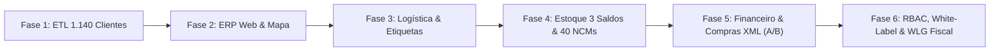

# 📅 Cronograma Geral & Status do Projeto: Mis Sueños ERP + Template Comercial `erp-base`

**Sistema Integrado de Gestão de Clientes, Estoque (3 Saldos), Pedidos, Financeiro, Compras XML, RBAC e Central Fiscal**  
**Desenvolvedor:** Gustavo Rosa Informática  
**Status Atual:** 100% Concluído (Produção Nuvem Vercel + Turso Cloud + Template White-Label)  
**Última Atualização:** 31/10/2026 - 00:12 (Horário de Brasília)

---

## 🧭 Visão Geral do Progresso

---

## 📊 Matriz Detalhada: Entregas Consolidadas (100%)

| Fase | Módulo / Recurso | Entregas Técnicas | Arquivos Relacionados | Status |
| :--- | :--- | :--- | :--- | :---: |
| **01** | **Extração e Base de Clientes** | • Extração inteligente de 1.140 arquivos `.docx` • Normalização de CPF/CNPJ, CEP e Cidades • Geração de SQLite indexado, CSV e JSON | [`scripts/converter_enderecos.py`](file:///d:/projetos-agy/MisSuenos/scripts/converter_enderecos.py) [`database/clientes.db`](file:///d:/projetos-agy/MisSuenos/database/clientes.db) | ✅ **100% Concluído** |
| **02** | **Interface Web ERP, PWA & Mapa** | • Layout responsivo moderno (Dark Mode ERP) + PWA instalável • Mapa SVG Interativo do Brasil com contagem por UF • Busca instantânea e filtros rápidos | [`public/index.html`](file:///d:/projetos-agy/MisSuenos/public/index.html) [`public/manifest.json`](file:///d:/projetos-agy/MisSuenos/public/manifest.json) [`public/sw.js`](file:///d:/projetos-agy/MisSuenos/public/sw.js) | ✅ **100% Concluído** |
| **03** | **Catálogo NCM & Estoque Inteligente (3 Saldos)** | • 29 produtos oficiais da planilha `NCM - LISTA PARA NF.xlsx` + 11 itens com NCM de 8 dígitos (total 40 itens) • Controle de 3 saldos: **Físico**, **Reservado em Pedidos** e **Disponível** • Reserva automática ao abrir pedido e conversão em baixa ao enviar | [`api/produtos.js`](file:///d:/projetos-agy/MisSuenos/api/produtos.js) [`api/pedidos.js`](file:///d:/projetos-agy/MisSuenos/api/pedidos.js) [`scripts/importar_ncm.js`](file:///d:/projetos-agy/MisSuenos/scripts/importar_ncm.js) | ✅ **100% Concluído** |
| **04** | **Módulo Financeiro (Pagar, Receber & Caixa)** | • Geração automática de **Contas a Receber** ao fechar pedidos • Lançamentos avulsos de Contas a Pagar e Receber • KPIs em tempo real (A Receber, A Pagar, Saldo Previsto, Vencidos) e baixa em 1 clique | [`api/financeiro.js`](file:///d:/projetos-agy/MisSuenos/api/financeiro.js) [`public/index.html`](file:///d:/projetos-agy/MisSuenos/public/index.html) | ✅ **100% Concluído** |
| **05** | **Compras & Importador Híbrido XML NF-e (A/B)** | • Leitura de `.xml` de NF-e de fornecedores (`<emit>`, `<dup>`, `<det>`) • Bloqueio idempotente contra reimportação pela `chave_nfe` (44 dígitos) • Escolha híbrida por item: **Opção (A) Apenas Despesa** ou **Opção (B) Somar no Estoque + Atualizar Custo** | [`api/compras.js`](file:///d:/projetos-agy/MisSuenos/api/compras.js) [`public/index.html`](file:///d:/projetos-agy/MisSuenos/public/index.html) | ✅ **100% Concluído** |
| **06** | **Autenticação Multi-Usuário (RBAC)** | • Login obrigatório com senhas individuais e sessões HMAC • Gestão visual de operadores e permissões por módulo na aba Configurações | [`lib/auth.js`](file:///d:/projetos-agy/MisSuenos/lib/auth.js) [`api/auth.js`](file:///d:/projetos-agy/MisSuenos/api/auth.js) [`api/usuarios.js`](file:///d:/projetos-agy/MisSuenos/api/usuarios.js) | ✅ **100% Concluído** |
| **07** | **Motor White-Label Dupla Camada (`erp-base`)** | • **Camada 1 (CLI):** `npm run configurar-ramo -- --ramo=couros\|informatica\|comercio\|oficina` • **Camada 2 (Web):** Edição em tempo real de nomes de menus, categorias e emitente na aba Configurações | [`api/configuracoes.js`](file:///d:/projetos-agy/MisSuenos/api/configuracoes.js) [`scripts/configurar_ramo.js`](file:///d:/projetos-agy/MisSuenos/scripts/configurar_ramo.js) | ✅ **100% Concluído** |
| **08** | **Conector Fiscal WLG Sistemas & SEFAZ** | • Integração REST `fiscal.wlgsistemas.com.br/api/v1` + Emissor TXT SEFAZ e DPS Nacional • Seleção automática de CFOP (`5102` RS / `6102` Interestadual) e validação de NCM | [`lib/wlg.js`](file:///d:/projetos-agy/MisSuenos/lib/wlg.js) [`api/nfe.js`](file:///d:/projetos-agy/MisSuenos/api/nfe.js) | ✅ **100% Concluído** |

---

## 📈 Resumo do Status Atual

| Área | Percentual Concluído | Observação |
| :--- | :---: | :--- |
| **Backend & Banco de Dados (SQLite + Turso Cloud)** | **100%** | Todas as tabelas v2 migradas e sincronizadas em nuvem. |
| **Lógica de Negócio & APIs Serverless** | **100%** | Clientes, Produtos (3 saldos), Pedidos, Financeiro, Compras XML, Configurações, Usuários e Fiscal ativos. |
| **Frontend, PWA & Usabilidade** | **100%** | Todos os módulos operacionais integrados no painel principal. |
| **Template Comercial White-Label (`erp-base`)** | **100%** | Dupla camada pronta para replicação com 1 conta Turso individual por empresa. |
| **GERAL DO PROJETO** | **100%** | **Especificação (`SPEC.md`) e Tickets (`TICKETS.md`) 100% implementados e validados.** |
