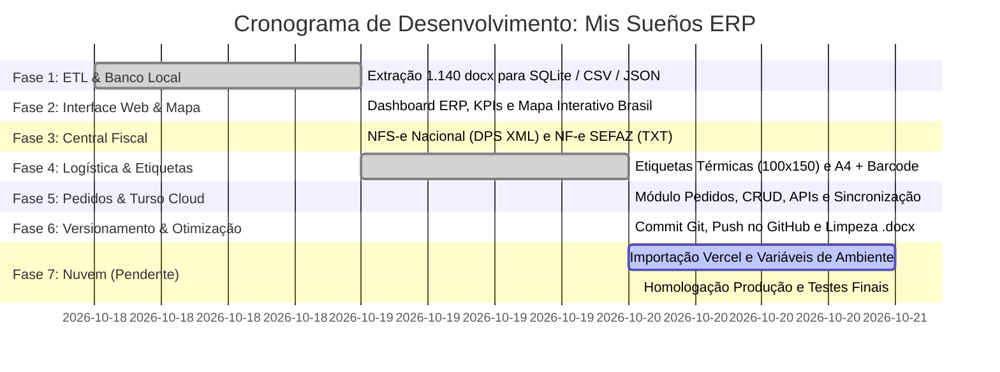

# 📅 Cronograma Geral & Status do Projeto: Mis Sueños ERP

**Sistema de Gestão de Clientes, Pedidos, Logística e Central Fiscal**  
**Desenvolvedor:** Gustavo Rosa Informática  
**Status Atual:** 88% Concluído (Pronto para Deploy na Nuvem)  
**Última Atualização:** 20/10/2026 - 22:01 (Horário de Brasília)

---

## 🧭 Visão Geral do Progresso

---

## 📊 Matriz Detalhada: O Que Já Foi Entregue

| Fase | Módulo / Recurso | Entregas Técnicas | Arquivos Relacionados | Status |
| :--- | :--- | :--- | :--- | :---: |
| **01** | **Extração e Base de Clientes** | • Extração inteligente de 1.140 arquivos `.docx` • Normalização de CPF/CNPJ, CEP e Cidades • Geração de SQLite indexado, CSV e JSON | [`scripts/converter_enderecos.py`](file:///d:/projetos-agy/MisSuenos/scripts/converter_enderecos.py) [`database/clientes.db`](file:///d:/projetos-agy/MisSuenos/database/clientes.db) [`public/dados_clientes.js`](file:///d:/projetos-agy/MisSuenos/public/dados_clientes.js) | ✅ **100% Concluído** |
| **02** | **Interface Web ERP & Dashboard** | • Layout responsivo moderno (Dark Mode ERP) • Mapa SVG Interativo do Brasil com contagem por UF • Busca instantânea com debounce e filtros de clientes • Alternância entre visualização em Cards e Tabela | [`public/index.html`](file:///d:/projetos-agy/MisSuenos/public/index.html) [`public/mapa_interativo.js`](file:///d:/projetos-agy/MisSuenos/public/mapa_interativo.js) [`scripts/servidor_web.js`](file:///d:/projetos-agy/MisSuenos/scripts/servidor_web.js) | ✅ **100% Concluído** |
| **03** | **Central Fiscal Unificada** | • Emissor de DPS para NFS-e Nacional (Receita Federal) • Emissor de NF-e mod. 55 para SEFAZ-RS / Sebrae • Histórico de faturamento e log de auditoria no banco | [`api/nfe.js`](file:///d:/projetos-agy/MisSuenos/api/nfe.js) [`api/logs.js`](file:///d:/projetos-agy/MisSuenos/api/logs.js) | ✅ **100% Concluído** |
| **04** | **Emissão e Pré-visualização de Etiquetas** | • Modal de impressão com pré-visualização real • Suporte nativo para impressora térmica (100x150 mm) • Suporte para folhas A4 (2 ou 4 etiquetas por folha) • Gerador dinâmico de Código de Barras SVG (Code 39) • Remetente Mis Sueños oficial pré-configurado • Botões de cópia rápida para Superfrete, Correios e Jadlog | [`public/index.html`](file:///d:/projetos-agy/MisSuenos/public/index.html) | ✅ **100% Concluído** |
| **05** | **Gestão de Pedidos & Turso Cloud** | • Tabela relacional `pedidos` criada com integridade • API Serverless REST (`GET`, `POST`, `PUT`, `DELETE`) • Modal de cadastro com autocomplete nos 1.140 clientes • Indicadores de status (`EM_SEPARACAO`, `AGUARDANDO_ENVIO`, etc.) • Banco na nuvem configurado no Turso (`aws-sa-east-1`) | [`api/pedidos.js`](file:///d:/projetos-agy/MisSuenos/api/pedidos.js) [`scripts/init_pedidos.js`](file:///d:/projetos-agy/MisSuenos/scripts/init_pedidos.js) [`lib/db.js`](file:///d:/projetos-agy/MisSuenos/lib/db.js) [`scripts/migrar_turso.js`](file:///d:/projetos-agy/MisSuenos/scripts/migrar_turso.js) | ✅ **100% Concluído** |
| **06** | **Versionamento & Otimização do Repositório** | • Código commitado e sincronizado no GitHub • Remoção da pasta pesada `ENDEREÇOS DE ENVIO` • Otimização do `.gitignore` para repositório enxuto | [GitHub MisSuenos](https://github.com/gustavorosainformatica/MisSuenos) [.gitignore](file:///d:/projetos-agy/MisSuenos/.gitignore) | ✅ **100% Concluído** |

---

## 🚀 O Que Falta Para Rodar 100% na Nuvem

Para o sistema sair do ambiente local e ficar disponível 24h na web para acesso de computador ou celular com custo zero, restam as seguintes tarefas:

### Etapa 7.1: Conectar o Repositório na Vercel (Tempo estimado: ~3 min)
- [ ] Acessar [vercel.com](https://vercel.com/) com a conta GitHub.
- [ ] Clicar em **Add New...** ➔ **Project** e selecionar `gustavorosainformatica/MisSuenos`.
- [ ] O Vercel detectará automaticamente as configurações de [`vercel.json`](file:///d:/projetos-agy/MisSuenos/vercel.json).

### Etapa 7.2: Inserir as Variáveis de Ambiente de Produção (Tempo estimado: ~2 min)
No painel da Vercel (*Environment Variables*), preencher os valores já ativos no arquivo [`.env`](file:///d:/projetos-agy/MisSuenos/.env):
- [ ] `TURSO_DATABASE_URL` = `libsql://missuenos-db-missuenos-sap.aws-sa-east-1.turso.io`
- [ ] `TURSO_AUTH_TOKEN` = `(Token JWT do Turso)`
- [ ] `R2_ACCOUNT_ID`, `R2_ACCESS_KEY_ID`, `R2_SECRET_ACCESS_KEY`, `R2_BUCKET_NAME` *(se desejar upload de anexos em nuvem pelo Cloudflare R2)*.

### Etapa 7.3: Deploy e Validação de Link Seguro (Tempo estimado: ~2 min)
- [ ] Clicar no botão **Deploy**.
- [ ] Obter a URL pública oficial (ex: `https://missuenos.vercel.app`).
- [ ] Testar acesso HTTPS e certificado SSL gratuito.

### Etapa 7.4: Homologação Ponta a Ponta na Nuvem (Tempo estimado: ~5 min)
- [ ] **Carregamento:** Abrir o link da Vercel no navegador e verificar os 1.140 clientes sendo servidos via Turso Cloud.
- [ ] **Pedidos:** Criar um pedido de teste e verificar a persistência instantânea no banco.
- [ ] **Etiquetas:** Gerar e simular a impressão de uma etiqueta térmica a partir do pedido.
- [ ] **Mobile:** Abrir o link no smartphone para testar a responsividade e comodidade de consulta.

---

## 📈 Resumo do Status Atual

| Área | Percentual Concluído | Observação |
| :--- | :---: | :--- |
| **Backend & Banco de Dados** | **100%** | SQLite local e Turso Cloud já populados e ativos. |
| **Lógica de Negócio & APIs** | **100%** | Clientes, Produtos, Pedidos, Fiscal e Anexos implementados. |
| **Frontend & Usabilidade** | **95%** | Pronto para uso; pequenos refinamentos visuais possíveis após feedback. |
| **Deploy & Infraestrutura Nuvem** | **45%** | Arquitetura serverless pronta e repositório limpo; falta ativar o projeto na Vercel. |
| **GERAL DO PROJETO** | **88%** | **Falta apenas a publicação e validação na Vercel.** |

---

## 🛠️ Próximo Passo Prioritário

Realizar a etapa **7.1 e 7.2**: abrir a dashboard da Vercel, importar o repositório `MisSuenos` e cadastrar as duas variáveis do Turso Cloud para vermos o sistema online em produção.
