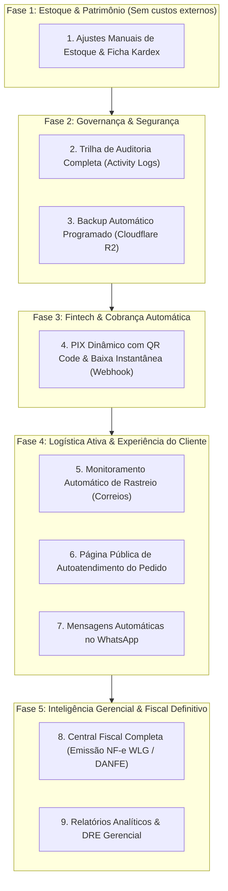

# 🗺️ Roadmap de Evolução & Roteiro Passo a Passo: Mis Sueños ERP

**Sistema:** Mis Sueños ERP (Selaria & Couros) + Template Base Comercial (`erp-base`)  
**Autor:** Gustavo Rosa Informática  
**Metodologia:** Fluxo de Engenharia Antigravity / Ciclo *Idea-to-Ship* (Matt Pocock)  
**Status do Projeto:** Fase MVP / Núcleo Operacional 100% Concluído  

---

## 🧭 Visão Geral do Roteiro (Passo a Passo)

Este documento é o seu **guia mestre de continuidade**. Quando você decidir retomar a evolução do ERP, basta consultar este roteiro e executar o comando do fluxo de engenharia correspondente a cada fase.

---

## 📋 Detalhamento Passo a Passo das Fases Futuras

---

### 📦 FASE 1: Inteligência de Estoque & Ficha Kardex (Sem APIs Externas)
> **Objetivo:** Dar controle patrimonial total sobre os couros e produtos, permitindo registrar perdas, descartes, sobras de corte e amostras sem furos no inventário.

* **O que será implementado:**
  1. **Tabela `estoque_movimentacoes`:** Histórico cronológico de cada unidade que entra ou sai (`tipo`, `origem`, `quantidade`, `saldo_anterior`, `saldo_posterior`, `motivo`, `usuario`).
  2. **Modal "Ajuste de Estoque":** Permite somar ou subtrair itens do estoque físico com justificativa obrigatória (*"Amostra enviada para cliente"*, *"Pele danificada/descarte"*, *"Ajuste de recontagem anual"*).
  3. **Extrato Kardex por Produto:** Aba no cadastro do produto mostrando o histórico de quem e quando mexeu naquele estoque.
* **Como iniciar esta fase no chat:**
  > Digite: `/grill-me Quero implementar o Módulo de Ajustes de Estoque e Ficha Kardex`

---

### 🛡️ FASE 2: Governança, Trilha de Auditoria & Backup Automático
> **Objetivo:** Blindar a operação contra erros humanos, rastrear alterações e garantir segurança de dados com múltiplos operadores.

* **O que será implementado:**
  1. **Tabela `logs_auditoria`:** Registra automaticamente ações críticas (*Ex: Operador alterou o preço do pedido #PED-1042; Operador excluiu o cliente #850*).
  2. **Visualizador de Auditoria:** Painel dentro do Menu do Sistema (`⚙️`) acessível apenas pelo administrador.
  3. **Rotina de Backup Noturno:** Script/cron agendado que exporta o banco e sobe automaticamente para o bucket do **Cloudflare R2** com retenção de 30 dias.
* **Como iniciar esta fase no chat:**
  > Digite: `/grill-me Quero implementar a Trilha de Auditoria e Backups Automáticos no R2`

---

### 💳 FASE 3: Fintech & Cobrança Automática (PIX Dinâmico com Baixa em Tempo Real)
> **Objetivo:** Eliminar conferência manual de extrato bancário e faturar pedidos no instante do pagamento.

* **O que será implementado:**
  1. **Integração com Gateway PIX:** Conexão com Mercado Pago, Asaas ou EFI (Gerencianet).
  2. **Geração de QR Code e Copia-e-Cola:** No fechamento do pedido, exibe o QR Code dinâmico na tela ou para envio ao cliente.
  3. **Endpoint de Webhook (`/api/webhook/pix`):** Recebe a confirmação do banco em menos de 2 segundos, mudando automaticamente o status da Conta a Receber para **`PAGO`** e liberando o pedido para expedição.
* **Como iniciar esta fase no chat:**
  > Digite: `/grill-me Quero integrar PIX Dinâmico com baixa automática via Webhook`

---

### 🚚 FASE 4: Logística Ativa, Autoatendimento & WhatsApp Transacional
> **Objetivo:** Eliminar o suporte repetitivo de clientes perguntando status de envio e profissionalizar o pós-venda.

* **O que será implementado:**
  1. **Monitor de Rastreio Automático:** Rotina em segundo plano que consulta os códigos de rastreio nos Correios e atualiza o pedido para `ENTREGUE` assim que o carteiro finalizar a entrega.
  2. **Página Pública de Autoatendimento:** Link seguro (ex: `missuenos.vercel.app/pedido/PED-1045?token=xyz`) que o cliente pode abrir pelo celular para ver itens, status e rastreamento.
  3. **Disparos Automáticos de WhatsApp:** Envio transacional de comprovante e código de rastreio direto para o WhatsApp do cliente.
* **Como iniciar esta fase no chat:**
  > Digite: `/grill-me Quero criar o Rastreamento Automático e Link de Autoatendimento do Cliente`

---

### 📊 FASE 5: Central Fiscal WLG Sistemas & Relatórios Gerenciais (DRE)
> **Objetivo:** Fechar o ciclo contábil oficial com emissão de NF-e autorizada pela SEFAZ e tomada de decisão executiva.

* **O que será implementado:**
  1. **Emissão de NF-e Modelo 55:** Envio do XML para a API da WLG Sistemas com download do DANFE em PDF e envio automático por e-mail para o cliente.
  2. **Painel de DRE Gerencial (Demonstrativo de Resultados):** Receitas brutas - Custos dos produtos - Despesas operacionais = Lucro Líquido Real.
  3. **Curva ABC de Clientes e Produtos:** Gráficos interativos mostrando quais são os 20% de clientes que trazem 80% do faturamento da selaria.
* **Como iniciar esta fase no chat:**
  > Digite: `/grill-me Quero concluir a Central Fiscal WLG e criar o Painel de DRE e Curva ABC`

---

## 🛠️ Como Funciona o Fluxo de Engenharia em Cada Fase

Sempre que você quiser executar uma das fases acima, o ciclo ideal de trabalho com o assistente será:

1. **Validação e Perguntas (`/grill-me`):**  
   Alinhamos os requisitos, tiramos dúvidas de regras de negócio e antecipamos riscos.
2. **Especificação Técnica (`/to-spec`):**  
   O assistente gera o documento de arquitetura formal da funcionalidade.
3. **Plano de Tarefas (`/to-tickets`):**  
   O assistente fatia o trabalho em tarefas pequenas, seguras e testáveis.
4. **Implementação Guiada (`/implement-spec`):**  
   Desenvolvimento passo a passo no ambiente de testes (`MisSuenos-Dev`), testando cada parte antes de promover para a produção (`MisSuenos`).
5. **Revisão de Código (`/code-review`):**  
   Auditoria de segurança, performance e conformidade com as regras antes do deploy oficial.
