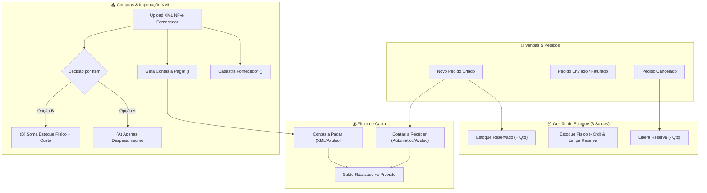

# Especificação Técnica: Conclusão do Mis Sueños ERP & Arquitetura do Template Comercial (`erp-base`)

**Autor:** Gustavo Rosa Informática  
**Data:** 30/10/2026  
**Status:** Validado via Sabatina Técnica (`/grill-me`)  
**Stack Oficial:** Node.js (ESM), SQLite Local (`node:sqlite`), Turso Cloud (`@libsql/client`), Cloudflare R2, Infisical, Vercel Serverless, PWA Standalone.

---

## 1. Visão Geral e Contexto

Este documento especifica as entregas finais para concluir 100% o **Mis Sueños ERP** e, simultaneamente, estruturar o código de forma desacoplada para operar como o **Template Base Comercial (`erp-base`)** da **Gustavo Rosa Informática**.

### Diretriz de Infraestrutura Multi-Cliente (Isolamento Total)
Cada empresa cliente atendida pelo template terá sua própria infraestrutura isolada:
- **1 Conta Individual no Turso Cloud por empresa** (ex: `missuenos-sap`), garantindo 100% da franquia gratuita exclusiva por CNPJ, segurança criptográfica isolada e independência financeira.
- **1 Projeto no Infisical / Vercel por empresa**, injetando as variáveis `TURSO_DATABASE_URL`, `TURSO_AUTH_TOKEN`, `R2_*` e `WLG_*` específicas daquela organização.

---

## 2. Metas e Fora de Escopo

### Metas Principais (In-Scope)
1. **Estoque com Reserva & Saneamento NCM:**
   - Adicionar suporte a códigos **NCM** nos produtos e importar a planilha oficial [`NCM-NF/NCM - LISTA PARA NF.xlsx`](file:///d:/projetos-agy/MisSuenos/NCM-NF/NCM%20-%20LISTA%20PARA%20NF.xlsx).
   - Controlar 3 saldos simultâneos por produto: **Estoque Físico (`estoque_atual`)**, **Estoque Reservado (`estoque_reservado`)** e **Estoque Disponível (`atual - reservado`)**.
   - Sinalizar produtos com vendas em andamento assim que o pedido for criado.
2. **Módulo Financeiro (Contas a Receber e Contas a Pagar):**
   - **Geração Automática de Contas a Receber:** Fechamento de pedido gera automaticamente os títulos financeiros (à vista já baixado ou a prazo/parcelado como pendente).
   - **Lançamentos Avulsos:** Inclusão manual simples de despesas operacionais (luz, frete, aluguel, insumos) e receitas avulsas.
   - **Painel de Fluxo de Caixa:** KPIs de Total a Receber, Total a Pagar, Inadimplência/Atrasados e Saldo Líquido.
3. **Módulo de Compras, Fornecedores & Importação de XML de NF-e:**
   - Cadastro formal de **Fornecedores**.
   - Leitor/Importador de arquivos `.xml` de NF-e de compra emitidas por fornecedores:
     - Cadastra/atualiza automaticamente o Fornecedor a partir da tag `<emit>`;
     - Lança automaticamente as faturas/boletos a partir da tag `<cobr><dup>` no **Contas a Pagar**;
     - Oferece escolha híbrida por item da nota (`<det><prod>`):
       - **Opção (A):** Apenas lançar despesa/fornecedor (ignorar impacto no estoque de produtos acabados);
       - **Opção (B):** Vincular o item a um produto existente no catálogo para somar o estoque físico e atualizar o preço de custo.
4. **Painel de Gestão de Usuários e Permissões (RBAC):**
   - Interface visual na aba **Configurações** (exclusiva para perfil `ADMIN`) permitindo listar, criar operadores internos, definir senhas personalizadas e marcar/desmarcar permissões granulares por módulo.
5. **Motor White-Label em Duas Camadas (`erp-base`):**
   - **Camada 1 (Setup Inicial por Ramo via CLI/Wizard):** Ao iniciar o template para um novo cliente, permite escolher o Ramo de Atividade (*Selaria & Couros*, *Informática & Assistência*, *Comércio Geral*, *Oficina/Autopeças*), pré-configurando automaticamente nomes de menus, categorias e unidades de medida.
   - **Camada 2 (Configuração Dinâmica na Interface Web):** Aba **Configurações** dentro do ERP que salva no banco (`configuracoes_sistema`) alterações de nome da empresa, CNPJ, dados fiscais, categorias e rótulos dos módulos em tempo real.
6. **Integração Fiscal Automatizada (WLG Sistemas REST API):**
   - Conectar o módulo fiscal à API gratuita `fiscal.wlgsistemas.com.br/api/v1` (NF-e Modelo 55), com definição automática de CFOP (`5102` intraestadual / `6102` interestadual) e download direto do DANFE (PDF) e XML autorizado.

### Fora de Escopo (Non-Goals)
- **Portal Externo do Cliente Final:** A coluna `cliente_id` já está preparada na tabela `usuarios`, mas a interface de acesso externo para os 1.140 clientes ficará para uma fase futura pós-implantação interna.
- **Banco de Dados Multi-Tenant Compartilhado:** Não haverá mistura de múltiplos CNPJs no mesmo banco Turso.
- **Obrigações Acessórias Contábeis Complexas:** Geração de SPED Fiscal, Bloco K ou folha de pagamento de RH.

---

## 3. Arquitetura e Fluxo de Execução



---

## 4. Contratos de Dados e Interfaces

### 4.1. Atualização da Tabela `produtos`
Adição das colunas `ncm` e `estoque_reservado`:
```sql
ALTER TABLE produtos ADD COLUMN ncm TEXT DEFAULT '';
ALTER TABLE produtos ADD COLUMN estoque_reservado REAL NOT NULL DEFAULT 0;
```
- **Cálculo de Disponibilidade:** `estoque_disponivel = estoque_atual - estoque_reservado`.

### 4.2. Nova Tabela `fornecedores`
```sql
CREATE TABLE IF NOT EXISTS fornecedores (
  id INTEGER PRIMARY KEY AUTOINCREMENT,
  razao_social TEXT NOT NULL,
  nome_fantasia TEXT,
  cnpj TEXT UNIQUE,
  ie TEXT,
  telefone TEXT,
  email TEXT,
  endereco TEXT,
  cidade TEXT,
  uf TEXT,
  cep TEXT,
  observacoes TEXT,
  ativo INTEGER DEFAULT 1,
  data_cadastro TEXT NOT NULL
);
```

### 4.3. Nova Tabela `financeiro_lancamentos`
```sql
CREATE TABLE IF NOT EXISTS financeiro_lancamentos (
  id INTEGER PRIMARY KEY AUTOINCREMENT,
  tipo TEXT NOT NULL, -- 'RECEBER' ou 'PAGAR'
  origem TEXT DEFAULT 'MANUAL', -- 'PEDIDO', 'XML_COMPRA', 'MANUAL'
  descricao TEXT NOT NULL,
  categoria TEXT DEFAULT 'Geral',
  cliente_id INTEGER,
  cliente_nome TEXT,
  fornecedor_id INTEGER,
  fornecedor_nome TEXT,
  pedido_id INTEGER,
  chave_nfe_origem TEXT,
  valor REAL NOT NULL DEFAULT 0,
  data_vencimento TEXT NOT NULL,
  data_pagamento TEXT,
  forma_pagamento TEXT DEFAULT 'PIX', -- 'PIX', 'BOLETO', 'DINHEIRO', 'CARTAO', 'TRANSFERENCIA'
  status TEXT NOT NULL DEFAULT 'PENDENTE', -- 'PENDENTE', 'PAGO', 'CANCELADO'
  comprovante_url TEXT,
  observacoes TEXT,
  data_cadastro TEXT NOT NULL,
  data_atualizacao TEXT
);
```

### 4.4. Nova Tabela `compras_xml` (Controle de Notas Importadas)
```sql
CREATE TABLE IF NOT EXISTS compras_xml (
  id INTEGER PRIMARY KEY AUTOINCREMENT,
  chave_nfe TEXT UNIQUE NOT NULL,
  numero_nfe TEXT,
  serie_nfe TEXT,
  fornecedor_id INTEGER,
  fornecedor_cnpj TEXT,
  fornecedor_nome TEXT,
  valor_total REAL DEFAULT 0,
  data_emissao TEXT,
  itens_json TEXT,
  xml_bruto TEXT,
  data_importacao TEXT NOT NULL
);
```

### 4.5. Nova Tabela `configuracoes_sistema` (Motor White-Label)
```sql
CREATE TABLE IF NOT EXISTS configuracoes_sistema (
  chave TEXT PRIMARY KEY,
  valor TEXT NOT NULL,
  data_atualizacao TEXT NOT NULL
);
```
Chaves principais:
- `ramo_atividade`: `'couros' | 'informatica' | 'comercio' | 'oficina'`
- `identidade_visual`: JSON com `{ nomeSistema, subtitulo, corPrimaria, logoUrl }`
- `emitente_fiscal`: JSON com `{ razaoSocial, nomeFantasia, cnpj, ie, cnae, crt, codigoIbge, endereco, uf, cep }`
- `nomenclaturas`: JSON com `{ menuProdutos, labelProduto, categoriasProdutos, unidadesMedida }`

### 4.6. Endpoints REST Serverless (`api/`)
- `api/produtos.js`: Suporte a `ncm` e `estoque_reservado`.
- `api/pedidos.js`: Ao criar pedido (`POST`), incrementa `estoque_reservado` dos itens e cria registro em `financeiro_lancamentos` (`RECEBER`). Ao mudar status para `ENVIADO`/`ENTREGUE`, desconta `estoque_atual` e reduz `estoque_reservado`. Ao cancelar/excluir, estorna `estoque_reservado` e cancela título financeiro pendente.
- `api/financeiro.js`: CRUD completo de Contas a Pagar/Receber, baixa rápida de títulos (`PUT` status=`PAGO`) e resumo de indicadores de caixa.
- `api/compras.js`: Parser de XML de NF-e no backend, criação automática de fornecedor, lançamento de duplicatas e vínculo opcional de estoque (Opções A e B).
- `api/configuracoes.js`: Leitura e gravação das configurações White-Label e presets de ramo.

---

## 5. Tratamento de Erros e Casos de Borda

1. **Idempotência na Importação de XML:**
   - Caso o operador tente importar o mesmo arquivo `.xml` duas vezes, o sistema verifica `chave_nfe` na tabela `compras_xml` e bloqueia a duplicação das contas a pagar e do estoque, exibindo aviso amigável.
2. **Proteção de Reserva de Estoque:**
   - `estoque_reservado` nunca pode ficar menor que zero (`MAX(0, estoque_reservado - qtd)`).
   - Caso um produto seja vendido acima do estoque disponível, o sistema alerta visualmente o operador, mas permite concluir o pedido caso seja encomenda sob produção.
3. **Resiliência do Motor White-Label:**
   - Caso o sistema inicie offline ou antes da resposta da API, `public/app-config.js` fornece o fallback instantâneo sem piscar a tela (*FOUC*).
4. **Segurança Fiscal WLG:**
   - Toda tentativa de emissão de NF-e valida previamente se todos os itens possuem código `ncm` de 8 dígitos e se o cliente possui CPF/CNPJ e CEP preenchidos, evitando rejeições na SEFAZ.

---

## 6. Critérios de Aceite e Testes

- [ ] **CA-01 (NCM e Estoque Reservado):** Todos os produtos da planilha `NCM - LISTA PARA NF.xlsx` importados com seus códigos NCM; criação de pedido reserva o estoque e exibe indicador *"⏳ X em pedido aberto"*; envio baixa o estoque físico.
- [ ] **CA-02 (Financeiro Automático e Avulso):** Criar um pedido gera automaticamente a conta a receber correspondente; operador consegue cadastrar uma conta a pagar avulsa e dar baixa como paga; KPIs refletem os saldos em tempo real.
- [ ] **CA-03 (Importação de XML Híbrida A/B):** Upload de um XML de NF-e extrai fornecedor, faturas e itens; permite escolher entre ignorar estoque (A) ou vincular a produto do catálogo somando saldo (B); bloqueia reimportação do mesmo XML.
- [ ] **CA-04 (Gestão de Usuários RBAC):** Administrador cria novo usuário na aba Configurações com senha própria e permissões customizadas; login com o novo usuário respeita rigorosamente os bloqueios.
- [ ] **CA-05 (White-Label Dual-Layer):** Script `npm run configurar-ramo` (e aba Configurações na Web) alterna o vocabulário do ERP entre ramos de atividade sem quebrar nenhuma função.
- [ ] **CA-06 (Sincronização Nuvem):** Todas as novas tabelas e rotas operacionais tanto no SQLite local quanto no Turso Cloud e publicadas na Vercel.

