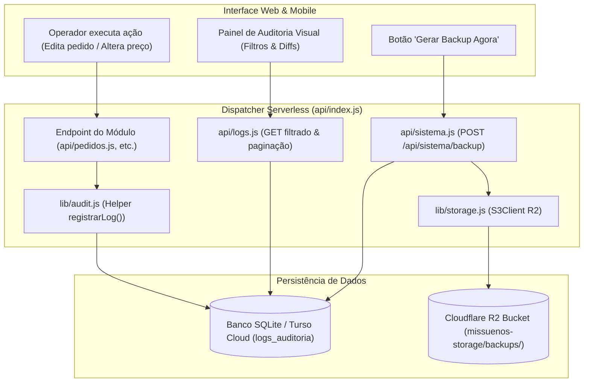

# 🛡️ Especificação Técnica: Trilha de Auditoria Visual & Backup Automático Cloudflare R2 (Fase 2)

> **Documento:** `SPEC_AUDITORIA_BACKUP.md`  
> **Status:** Proposta de Arquitetura (Validada via `/to-spec`)  
> **Projeto:** Mis Sueños ERP v2.0 (`d:\projetos-agy\clientes\MisSuenos`)  
> **Autor:** Gustavo Rosa Informática  
> **Governança:** Nível 1 (PT-BR, Zero-PII, Padrões UI/UX Modernos, Arquitetura Serverless Unificada)

---

## 1. Visão Geral e Contexto

Com o avanço do **Mis Sueños ERP v2.0** e o suporte a múltiplos operadores (administrador, vendedores e operadores de galpão), tornou-se essencial garantir a **rastreabilidade total das operações críticas** e a **resiliência patrimonial dos dados**.

Esta especificação resolve dois desafios centrais de governança:
1. **Trilha de Auditoria Completa & Visual (Activity Log):** Transformar o registro de logs em uma camada padronizada de telemetria visual no painel do administrador, permitindo saber **quem**, **quando**, **onde (IP/Dispositivo)** e **o que** foi alterado (com comparativo antes vs. depois) em Pedidos, Clientes, Produtos, Preços e Títulos Financeiros.
2. **Rotina de Backup Noturno & Sob Demanda no Cloudflare R2:** Automatizar a criação de dumps criptografados/compactados do banco de dados (SQLite local e Turso Cloud) diretamente para o bucket Cloudflare R2 (`missuenos-storage/backups/`), com política de retenção rotativa de 30 dias e botão de disparo imediato na interface.

---

## 2. Metas e Fora de Escopo

### 🎯 Metas Principais (In-Scope)
- **Tabela `logs_auditoria` Unificada & Padronizada:** Padronizar o payload JSON de `campos_alterados` e `detalhes` em todos os módulos (Clientes, Pedidos, Produtos, Estoque e Financeiro), gravando sempre o `usuario_id`, `usuario_nome`, `ip_origem`, `tipo_acao` e timestamp ISO.
- **Painel Visual de Auditoria (`#modal-auditoria-sistema`):**
  - Acesso restrito a usuários com perfil de Administrador (`is_admin`).
  - Filtros rápidos por: Período (Hoje, 7 dias, 30 dias), Operador, Módulo (`PEDIDOS`, `CLIENTES`, `ESTOQUE`, `FINANCEIRO`, `SISTEMA`) e Tipo de Ação (`CRIACAO`, `ALTERACAO`, `EXCLUSAO`, `LOGIN`, `ESTORNO`).
  - Drawer ou modal expandido para inspecionar o diff JSON (`Valor Anterior` ➔ `Novo Valor`).
- **Endpoint de Backup Seguro (`/api/sistema/backup`):**
  - Geração de snapshot atômico do banco de dados (SQLite `/database/clientes.db` e dump de tabelas do Turso).
  - Compactação gzip com nome formatado: `backup_missuenos_YYYY-MM-DD_HHmmss.sqlite.gz`.
  - Upload via S3 SDK para a pasta `backups/` do Cloudflare R2.
  - Listagem dos últimos 30 backups disponíveis com tamanho, data e link seguro de download assinado (presigned URL).
- **Disparo em Duas Vias:**
  - **Via Interface (1 clique):** Botão *"Gerar Backup Agora"* no menu de configurações com progresso visual.
  - **Via Script CLI / Cron (`scripts/executar_backup_r2.js`):** Script automatizado para execução noturna via Windows Task Scheduler ou GitHub Actions agendado.

### 🚫 Fora de Escopo (Non-Goals)
- Restauração automática de banco em 1 clique pela interface web (por segurança de infraestrutura, restores continuam sendo operados via CLI com confirmação explícita de rollback).
- Replicação síncrona multi-região além do que o Turso Cloud já fornece nativamente.
- Armazenamento de senhas ou PINs de operadores na trilha de auditoria (blindagem de segurança estrita).

---

## 3. Arquitetura e Fluxo de Execução

### Diagrama de Fluxo: Auditoria e Backup



---

## 4. Contratos de Dados, Interfaces e Padrões de UI/UX

### A. Estrutura da Tabela `logs_auditoria` (Evolução do Schema)

```sql
CREATE TABLE IF NOT EXISTS logs_auditoria (
    id INTEGER PRIMARY KEY AUTOINCREMENT,
    usuario_id INTEGER,                     -- ID do operador que realizou a ação
    usuario_nome TEXT NOT NULL,             -- Nome do operador (ex: "GUSTAVO ROSA")
    modulo TEXT NOT NULL,                   -- "PEDIDOS", "CLIENTES", "ESTOQUE", "FINANCEIRO", "SISTEMA"
    tipo_acao TEXT NOT NULL,                -- "CRIACAO", "EDICAO", "EXCLUSAO", "STATUS_CHANGE", "ESTORNO", "LOGIN"
    referencia_id TEXT,                     -- Identificador do objeto (ex: "#PED-1048", "CLIENTE #1140", "SKU-PEL-01")
    descricao TEXT NOT NULL,                -- Frase explicativa em PT-BR
    dados_anteriores TEXT,                  -- JSON stringified com o estado anterior
    dados_novos TEXT,                       -- JSON stringified com o novo estado
    ip_origem TEXT,                         -- IP do cliente
    user_agent TEXT,                        -- Dispositivo / Navegador
    data_hora TEXT NOT NULL                 -- Timestamp ISO 8601 (UTC-3)
);

CREATE INDEX IF NOT EXISTS idx_logs_modulo_data ON logs_auditoria (modulo, data_hora);
CREATE INDEX IF NOT EXISTS idx_logs_usuario ON logs_auditoria (usuario_id);
CREATE INDEX IF NOT EXISTS idx_logs_referencia ON logs_auditoria (referencia_id);
```

### B. Helper Central de Registro (`lib/audit.js`)

```javascript
/**
 * Registra um evento de auditoria no banco ativo
 */
export async function registrarLog({
  usuarioId = null,
  usuarioNome = 'SISTEMA',
  modulo,
  tipoAcao,
  referenciaId = null,
  descricao,
  dadosAnteriores = null,
  dadosNovos = null,
  req = null
}) { ... }
```

### C. Endpoints REST (Roteados pelo Dispatcher Único `api/index.js`)

1. **`GET /api/logs`**
   - Parâmetros: `modulo`, `tipo_acao`, `usuario_id`, `data_inicio`, `data_fim`, `busca`, `page`, `limit`.
   - Retorno: `{ logs: [...], total: 154, page: 1, totalPages: 4 }`.
2. **`POST /api/sistema/backup`**
   - Dispara a compactação e envio ao Cloudflare R2.
   - Retorno: `{ sucesso: true, arquivo: "backup_missuenos_2026-11-13_150000.sqlite.gz", tamanhoBytes: 442150, r2Key: "backups/...", urlDownload: "..." }`.
3. **`GET /api/sistema/backups`**
   - Lista os backups armazenados no R2 com presigned URLs para download imediato.

### D. Padrões Obrigatórios de UI/UX
- **Caixa Alta Universal:** Textos e filtros digitáveis normalizados em uppercase (`text-transform: uppercase !important;`).
- **Ergonomia de Teclado:** A tecla `Tab` circula estritamente entre filtros e campos de busca. Botões de ação rápida, visualização de JSON e fechar modal possuem `tabindex="-1"`.
- **Foco Automático:** Ao abrir o modal de auditoria, foca instantaneamente no campo de busca de log (`setTimeout(..., 50)`).
- **Visualização de Diff Clara:** Cards lado a lado:
  - 🟥 Vermelho translúcido para campos antes da alteração.
  - 🟩 Verde esmeralda translúcido para novos valores.

---

## 5. Tratamento de Erros, Casos de Borda e Integridade

| Cenário de Borda | Comportamento Esperado |
| :--- | :--- |
| **Credenciais do R2 ausentes no ambiente** | O sistema gera o backup na pasta local `/public/backups/`, avisa no log visual que operou em modo local e não quebra a interface. |
| **Operação de banco concorrente durante o backup** | Utilizar `VACUUM INTO` do SQLite ou cópia transacional segura para evitar corrupção de arquivo em caso de escrita simultânea. |
| **Exclusão de registros com PII** | A auditoria registra a exclusão do cliente/pedido, mas mascara documentos pessoais nos payloads JSON (`***.456.789-**`), em estrito respeito à regra **Zero-PII**. |
| **Volume de logs crescendo indefinidamente** | Rotina de arquivamento para cold storage R2 (`api/sistema.js`) exporta registros com mais de 90 dias em formato CSV e libera espaço da tabela. |

---

## 6. Critérios de Aceite e Testes (TDD)

### Critérios de Aceite
1. **[CA-01]** Ações de alteração de status em Pedidos (`AGUARDANDO_PAGAMENTO` ➔ `EM_SEPARACAO`), ajustes de estoque e cancelamentos gravam automaticamente na tabela `logs_auditoria`.
2. **[CA-02]** A tela de Auditoria lista os eventos ordenados cronologicamente, com badge colorido por módulo e visualizador de diff legível.
3. **[CA-03]** O endpoint `POST /api/sistema/backup` gera o arquivo compactado `.sqlite.gz` e realiza upload com sucesso no Cloudflare R2.
4. **[CA-04]** O endpoint `GET /api/sistema/backups` retorna a lista de backups com data, tamanho formatado e presigned URL válida para download.
5. **[CA-05]** O script CLI `scripts/executar_backup_r2.js` pode ser executado via terminal Windows/PowerShell sem erros.
6. **[CA-06]** Todos os novos endpoints e funções contam com testes automatizados dedicados em `tests/auditoria_backup.test.js` integrados à suíte `npm test`.

---

## 7. Próximo Passo do Fluxo de Engenharia

Com a especificação formalmente registrada em [SPEC_AUDITORIA_BACKUP.md](file:///d:/projetos-agy/clientes/MisSuenos/SPEC_AUDITORIA_BACKUP.md), o próximo passo é executar:

> **`/to-tickets`** para fatiar esta especificação em tickets de implementação atômicos, testáveis e ordenados.

