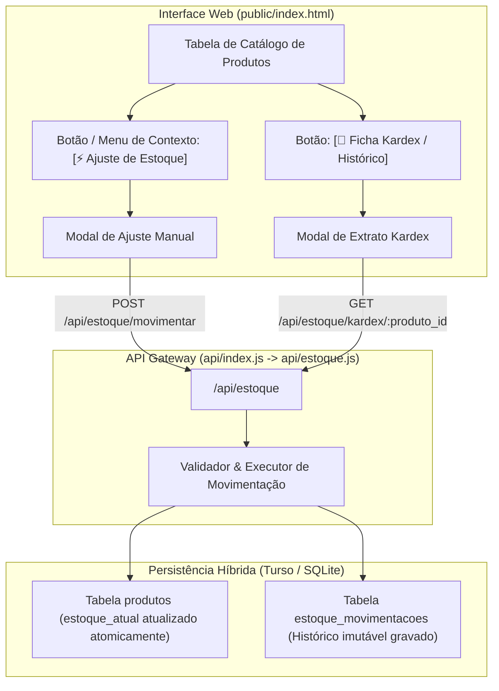

# Especificação Técnica: Módulo Universal de Estoque & Ficha Kardex

**Documento:** `SPEC_ESTOQUE_KARDEX.md`  
**Autor:** Gustavo Rosa Informática  
**Status:** Validado e Aprovado (Ciclo *Idea-to-Ship* / Etapa 2: `/to-spec`)  
**Compatibilidade:** Mis Sueños ERP (`d:\projetos-agy\MisSuenos`), Homologação (`MisSuenos-Dev`) e Template Base White-Label (`erp-base`)  

---

## 1. Visão Geral e Contexto
Atualmente, o ERP controla o inventário através de uma coluna estática (`estoque_atual`) na tabela `produtos`. Embora permita saber o saldo momentâneo, **não existe rastreabilidade histórica**: não é possível auditar quem alterou uma quantidade, quando a alteração ocorreu, nem por qual justificativa operacional (ex: venda, descarte por avaria, sobras de corte em couros, comodato em locação de computadores, ou ajuste de inventário).

O **Módulo Universal de Estoque & Ficha Kardex** implementa uma arquitetura contábil-patrimonial completa e multi-ramo, permitindo o registro granular de cada unidade que entra ou sai do estoque com cálculo de saldo anterior, saldo posterior e extrato cronológico (*Ficha Kardex*).

---

## 2. Metas e Fora de Escopo

### 🎯 Metas Principais (In-Scope):
1. **Rastreabilidade Histórica Total (Audit Trail):** Toda e qualquer alteração de saldo gera um registro imutável na tabela `estoque_movimentacoes`.
2. **Arquitetura Agnóstica Multi-Ramo (White-Label):** Motivos de movimentação que atendem com perfeição a selarias/couros, lojas de móveis, artesanato e locadoras de equipamentos/TI.
3. **Ficha Kardex Interativa no Frontend:** Modal e aba de consulta do extrato histórico por produto com filtros de período, busca rápida e indicação visual de entradas (verde) e saídas (vermelho).
4. **Ajuste Manual Rápido:** Modal ágil com acionamento por botão de ação e botão direito (menu de contexto) na tabela de produtos.
5. **Blindagem de Quotas da Vercel:** O novo endpoint de estoque será roteado através do Dispatcher Central (`api/index.js`), consumindo zero funções serverless adicionais.
6. **Integridade Híbrida:** Suporte transparente ao SQLite local e ao Turso Cloud via `@libsql/client`.

### 🚫 Fora de Escopo (Non-Goals):
- Controle de estoque por múltiplos galpões/armazéns físicos (multi-warehouse) — mantido armazém único nesta versão.
- Leitura de código de barras por câmera do smartphone (previsto para fase futura de PWA mobile).

---

## 3. Arquitetura e Fluxo de Execução



---

## 4. Contratos de Dados e Interfaces

### 4.1 Schema da Tabela `estoque_movimentacoes` (SQLite / Turso)
```sql
CREATE TABLE IF NOT EXISTS estoque_movimentacoes (
  id INTEGER PRIMARY KEY AUTOINCREMENT,
  produto_id INTEGER NOT NULL,
  tipo TEXT NOT NULL CHECK(tipo IN ('ENTRADA', 'SAIDA')),
  origem TEXT NOT NULL CHECK(origem IN ('COMPRA', 'VENDA', 'AJUSTE_MANUAL', 'INVENTARIO', 'PRODUCAO', 'LOCACAO')),
  motivo TEXT NOT NULL,
  quantidade REAL NOT NULL CHECK(quantidade > 0),
  saldo_anterior REAL NOT NULL,
  saldo_posterior REAL NOT NULL,
  custo_unitario REAL DEFAULT 0,
  documento_referencia TEXT,
  observacoes TEXT,
  operador_id INTEGER,
  operador_nome TEXT,
  data_movimentacao DATETIME DEFAULT CURRENT_TIMESTAMP,
  FOREIGN KEY (produto_id) REFERENCES produtos(id)
);

CREATE INDEX IF NOT EXISTS idx_estoque_mov_prod ON estoque_movimentacoes(produto_id, data_movimentacao DESC);
```

### 4.2 Catálogo de Motivos Universais Padronizados
- **ENTRADA:**
  - `COMPRA_FORNECEDOR` — Compra de Fornecedor / Entrada por NF-e
  - `INVENTARIO_INICIAL` — Inventário Inicial / Balanço Positivo
  - `DEVOLUCAO_CLIENTE` — Devolução de Cliente / Estorno de Pedido
  - `RETORNO_LOCACAO` — Retorno de Equipamento / Fim de Contrato de Locação
  - `APROVEITAMENTO_CORTE` — Aproveitamento de Sobras / Retalhos Úteis
- **SAÍDA:**
  - `VENDA_PEDIDO` — Venda Faturada / Saída por Pedido
  - `AVARIA_DESCARTE` — Avaria / Pele Danificada / Quebra
  - `SAIDA_LOCACAO` — Saída para Locação / Comodato em Cliente
  - `AMOSTRA_DEMONSTRACAO` — Amostra Grátis para Cliente / Mostruário
  - `USO_CONSUMO_INTERNO` — Uso e Consumo Interno / Manutenção / Oficina
  - `AJUSTE_BALANCO_NEGATIVO` — Ajuste de Balanço / Perda de Inventário

### 4.3 Endpoints REST

#### `POST /api/estoque/movimentar`
- **Payload:**
  ```json
  {
    "produto_id": 15,
    "tipo": "SAIDA",
    "motivo": "AVARIA_DESCARTE",
    "quantidade": 2,
    "documento_referencia": "AV-2026/11",
    "observacoes": "Pele com corte defeituoso de curtume",
    "custo_unitario": 45.00
  }
  ```
- **Resposta Sucesso (201 Created):**
  ```json
  {
    "success": true,
    "mensagem": "Movimentação registrada com sucesso",
    "movimentacao_id": 142,
    "saldo_anterior": 10,
    "saldo_atual": 8
  }
  ```

#### `GET /api/estoque/kardex/:produto_id?inicio=2026-01-01&fim=2026-11-05&limite=50`
- **Resposta Sucesso (200 OK):**
  ```json
  {
    "success": true,
    "produto": {
      "id": 15,
      "codigo_sku": "COU-001",
      "nome": "Couro Bovino Crazy Horse",
      "unidade": "UNID",
      "estoque_atual": 8
    },
    "totais": {
      "total_entradas": 20,
      "total_saidas": 12
    },
    "movimentacoes": [ ... ]
  }
  ```

---

## 5. Tratamento de Erros e Casos de Borda

1. **Tentativa de Saída Maior que o Estoque Atual:**
   - O sistema valida se `tipo === 'SAIDA'` e `quantidade > saldo_anterior`.
   - Bloqueia com HTTP 400 (*"Estoque insuficiente: saldo atual é X, tentativa de saída de Y"*).
2. **Concorrência e Atomicidade:**
   - A operação de inserção em `estoque_movimentacoes` e atualização em `produtos` é executada em bloco único com bloqueio de consistência, evitando condições de corrida.
3. **Resiliência Offline / Falha de Rede:**
   - Se o Turso Cloud estiver offline, o sistema realiza fallback seguro para o SQLite local e marca para sincronização futura.

---

## 6. Critérios de Aceite e Verificação

- [ ] A tabela `estoque_movimentacoes` é criada automaticamente se não existir, sem resetar a base existente.
- [ ] O operador consegue realizar um ajuste manual (positivo e negativo) em menos de 10 segundos.
- [ ] O saldo em `produtos.estoque_atual` é atualizado na hora e refletido na tabela visual do catálogo.
- [ ] A Ficha Kardex exibe o histórico cronológico exato com cores distintas para entradas e saídas.
- [ ] As rotas continuam respondendo através de `api/index.js`, preservando a cota de 1 Serverless Function na Vercel.
- [ ] Sincronização homologada entre `MisSuenos`, `MisSuenos-Dev` e `erp-base`.

