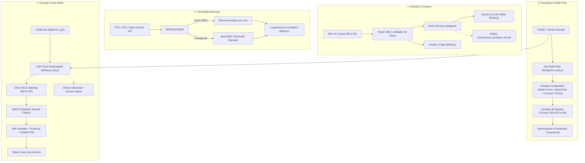

# Especificação Técnica: Suíte Empresarial de Suprimentos, Logística, Conciliação e Inteligência Fiscal

> **Projeto:** Mis Sueños ERP & Matriz Universal ERP Base  
> **Status:** Aprovado em Sabatina (/grill-me) — Pronto para Execução  
> **Autor:** Gustavo Rosa Informática & Antigravity  
> **Data:** 10 de Novembro de 2026  
> **Versão:** 1.0.0  

---

## 1. Visão Geral e Contexto

A evolução da suíte empresarial do **Mis Sueños ERP** e de sua matriz neutra **ERP Base** (`d:\projetos-agy\erp-base`) visa fechar o ciclo operacional completo de ponta a ponta: desde a entrada de mercadorias e matérias-primas por fornecedores até a expedição logística, baixa bancária automática e emissão fiscal oficial perante a Receita Federal e SEFAZ.

Atualmente, o ERP já dispõe de módulos consolidados de Pedidos, Catálogo, Clientes, Financeiro, DRE Analítico e Fluxo de Caixa Projetado. Esta especificação formaliza a integração de **4 pilares fundamentais**:

1. **Compras & Entrada de Estoque (XML Fornecedor):** Importação automatizada de NF-e Modelo 55 via XML, inteligência De-Para de produtos memorizada por fornecedor, atualização em tempo real de kardex/estoque e lançamento automático de faturas no Contas a Pagar.
2. **Expedição, Fretes & Rastreamento (Hub Multi-Frete):** Gateway desacoplado de logística (`lib/logistica_hub.js`) com cotação comparativa em tempo real entre transportadoras (Melhor Envio, SuperFrete, Correios CWS, Frenet), seletor de transportadora padrão no painel e geração instantânea de etiquetas térmicas (`100x150 mm`) e em folha `A4` (com Declaração de Conteúdo e DANFE Simplificada).
3. **Conciliação Bancária & Open Finance:** Conexão com APIs bancárias / Open Finance para conciliação contínua, com contingência (*fallback*) obrigatória e robusta para importação de extratos `.OFX` e `.CSV`, motor de correspondência (*matching engine*) de alta precisão e reconciliação em lote.
4. **Emissão Fiscal Oficial (Hub Fiscal Desacoplado):** Gateway fiscal extensível (`lib/fiscal_hub.js`) com suporte nativo a Certificado Digital A1 (`.pfx`), driver conector prioritário para **WLG Sistemas** (NF-e Mod 55 e NFS-e Padrão Nacional DPS) e arquitetura preparada para múltiplos provedores ou emissão nativa direta.

---

## 2. Metas e Fora de Escopo

### 2.1 Metas Principais (Goals)
- **Neutralidade Absoluta no ERP Base:** Toda tabela, interface e conector deve operar de forma desacoplada no `erp-base`, sem amarrações de segmento (móveis, TI, artesanato ou serviços), com parametrização em banco de dados (`configuracoes_empresa`).
- **De-Para Inteligente e Auto-Aprendizagem:** O sistema deve memorizar cada associação feita entre o código/cEAN do fornecedor e o produto interno do catálogo. Nas próximas compras do mesmo fornecedor, o vínculo é pré-selecionado automaticamente.
- **Hub Multi-Frete Dinâmico:** Permitir que múltiplas transportadoras fiquem ativas simultaneamente, exibindo cotação comparativa de menor preço e menor prazo, mantendo um provedor padrão configurável.
- **Etiquetas de Envio Híbridas:** Impressão em 1 clique tanto no padrão de impressoras térmicas (Zebra, Argox, Elgin `100x150 mm`) quanto no formato convencional folha A4 (com 2 a 4 etiquetas ou DANFE simplificada).
- **Conciliação Resiliente:** Importação tolerante a falhas de arquivos OFX/CSV dos principais bancos brasileiros (Itaú, Bradesco, Santander, BB, Inter, Cora, Nubank, Sicredi, Sicoob), com conciliação automática para score de 100% e sugestão visual para discrepâncias de data (+/- 3 dias).
- **Certificado Digital A1 Universal:** Gestão centralizada do arquivo de certificado `.pfx` com criptografia de senha e leitura de metadados (validade, titular, CNPJ).
- **Blindagem Serverless Vercel Hobby:** Centralização de 100% dos novos endpoints no Dispatcher Central único (`api/index.js`), consumindo rigorosamente 1 Serverless Function.
- **Ergonomia de Teclado e Acessibilidade:** Conformidade estrita com as regras de Caixa Alta Universal, Tab estrito em digitáveis, remoção de spinners numéricos, Combobox pesquisável integrado e foco automático nos modais.

### 2.2 Fora de Escopo (Non-Goals)
- Emissão direta de CTe (Conhecimento de Transporte Eletrônico) para frotas de terceiros (o ERP é focado em embarcadores/empresas comerciais).
- Suporte a Certificados Digitais A3 baseados em Smartcards físicos ou Tokens USB (devido à incompatibilidade de drivers de hardware locais em ambientes serverless em nuvem — o padrão oficial é A1).
- Módulo de folha de pagamento ou cálculo de previdência social/eSocial nesta etapa.

---

## 3. Arquitetura e Fluxo de Execução



### 3.1 Módulos de Backend e Helpers
1. **`lib/compras_parser.js`:** Parser especializado em extração de dados fiscais de NF-e Modelo 55 (dados do emitente, produtos `<det>`, tributos `<imposto>`, cobrança `<dup>`).
2. **`lib/logistica_hub.js`:** Hub de logística com interface abstrata e adaptadores (*Adapters*) para cada provedor de frete homologado.
3. **`lib/conciliacao_bancaria.js`:** Parser de arquivos `.OFX` (SGML/XML) e `.CSV` com algoritmo heurístico de reconciliação de contas.
4. **`lib/fiscal_hub.js`:** Hub desacoplado com gerenciador de Certificado A1 e drivers fiscais (iniciando por `lib/wlg.js`).
5. **`api/index.js`:** Despachante único serverless que roteia para `api/compras.js`, `api/logistica.js`, `api/financeiro.js` e `api/nfe.js`.

---

## 4. Contratos de Dados, Interfaces e Padrões de UI/UX

### 4.1 Modelo de Dados Relacional (Novas Tabelas e Extensões)

```sql
-- 1. Tabela de Vínculo De-Para Inteligente de Produtos do Fornecedor
CREATE TABLE IF NOT EXISTS fornecedores_produtos_vinculo (
  id INTEGER PRIMARY KEY AUTOINCREMENT,
  fornecedor_id INTEGER NOT NULL,
  codigo_fornecedor TEXT NOT NULL,
  ean_fornecedor TEXT,
  descricao_fornecedor TEXT NOT NULL,
  produto_erp_id INTEGER NOT NULL,
  fator_conversao REAL DEFAULT 1.0, -- Ex: caixa com 12 unidades vira 12 no estoque
  unidade_fornecedor TEXT,
  criado_em TEXT DEFAULT CURRENT_TIMESTAMP,
  atualizado_em TEXT DEFAULT CURRENT_TIMESTAMP,
  UNIQUE(fornecedor_id, codigo_fornecedor)
);

-- 2. Tabela de Provedores de Frete e Configurações de Logística
CREATE TABLE IF NOT EXISTS transportadoras_config (
  id TEXT PRIMARY KEY, -- 'melhor_envio', 'superfrete', 'correios_cws', 'frenet'
  nome TEXT NOT NULL,
  ativo INTEGER DEFAULT 0,
  padrao INTEGER DEFAULT 0,
  token_acesso TEXT,
  ambiente TEXT DEFAULT 'producao', -- 'sandbox' ou 'producao'
  formato_etiqueta_padrao TEXT DEFAULT 'termica_100x150', -- 'termica_100x150' ou 'folha_a4'
  dados_origem_json TEXT, -- CEP, endereço e documento do remetente
  criado_em TEXT DEFAULT CURRENT_TIMESTAMP,
  atualizado_em TEXT DEFAULT CURRENT_TIMESTAMP
);

-- 3. Tabela de Extratos Bancários e Conciliação
CREATE TABLE IF NOT EXISTS conciliacao_extratos (
  id INTEGER PRIMARY KEY AUTOINCREMENT,
  conta_bancaria_id INTEGER,
  origem TEXT NOT NULL, -- 'OFX', 'CSV', 'API_OPEN_FINANCE'
  fitid TEXT UNIQUE, -- Identificador único da transação bancária no OFX
  data_transacao TEXT NOT NULL,
  descricao TEXT NOT NULL,
  tipo TEXT NOT NULL, -- 'CREDITO' ou 'DEBITO'
  valor REAL NOT NULL,
  status TEXT DEFAULT 'PENDENTE', -- 'PENDENTE', 'CONCILIADO', 'IGNORADO'
  transacao_financeiro_id INTEGER, -- FK para transacoes_financeiras
  score_match REAL DEFAULT 0.0,
  criado_em TEXT DEFAULT CURRENT_TIMESTAMP
);

-- 4. Tabela de Configuração Fiscal e Certificado Digital A1
CREATE TABLE IF NOT EXISTS fiscal_config (
  id INTEGER PRIMARY KEY AUTOINCREMENT,
  ambiente TEXT DEFAULT 'homologacao', -- 'homologacao' ou 'producao'
  driver_ativo TEXT DEFAULT 'wlg', -- 'wlg', 'focus', 'nativo'
  provedor_token TEXT,
  certificado_a1_base64 TEXT, -- Armazenamento criptografado do arquivo .pfx
  certificado_senha TEXT, -- Criptografada
  certificado_valido_ate TEXT,
  certificado_cnpj TEXT,
  certificado_razao_social TEXT,
  serie_nfe INTEGER DEFAULT 1,
  ultimo_numero_nfe INTEGER DEFAULT 0,
  serie_nfse INTEGER DEFAULT 1,
  ultimo_numero_nfse INTEGER DEFAULT 0,
  atualizado_em TEXT DEFAULT CURRENT_TIMESTAMP
);

-- 5. Tabela de Histórico e Armazenamento de Documentos Fiscais Emitidos
CREATE TABLE IF NOT EXISTS fiscal_documentos (
  id INTEGER PRIMARY KEY AUTOINCREMENT,
  pedido_id INTEGER,
  tipo TEXT NOT NULL, -- 'NFE_55' ou 'NFSE'
  numero INTEGER NOT NULL,
  serie INTEGER NOT NULL,
  chave_acesso TEXT UNIQUE,
  protocolo_autorizacao TEXT,
  status TEXT NOT NULL, -- 'AUTORIZADA', 'REJEITADA', 'CANCELADA', 'PROCESSANDO'
  motivo_status TEXT,
  xml_assinado TEXT,
  danfe_pdf_url TEXT,
  emitido_em TEXT DEFAULT CURRENT_TIMESTAMP,
  FOREIGN KEY(pedido_id) REFERENCES pedidos(id)
);
```

### 4.2 Endpoints REST (Centralizados em `api/index.js`)

| Método | Endpoint | Módulo | Descrição do Contrato |
| :--- | :--- | :--- | :--- |
| `POST` | `/api/compras/importar-xml` | `compras.js` | Recebe arquivo XML (`multipart` ou JSON com `xmlContent`), valida idempotência da chave de 44 dígitos e extrai itens, emitente e parcelas. |
| `POST` | `/api/compras/confirmar-entrada` | `compras.js` | Grava vínculos De-Para, gera lançamentos no Contas a Pagar e abastece o estoque com histórico de kardex. |
| `GET` | `/api/compras/de-para/:fornecedorId` | `compras.js` | Retorna o mapa de vínculos prévios memorizados daquele fornecedor. |
| `POST` | `/api/logistica/cotar` | `logistica.js` | Recebe `{ cepOrigem, cepDestino, pesoKg, dimensoes: { c, l, a } }` e retorna cotações em paralelo de todos os provedores ativos. |
| `POST` | `/api/logistica/gerar-etiqueta` | `logistica.js` | Recebe `{ pedidoId, provedor, formato }` e retorna PDF da etiqueta (térmica ou A4) com código de rastreio oficial. |
| `POST` | `/api/financeiro/conciliacao/upload` | `financeiro.js` | Recebe arquivo `.OFX` ou `.CSV`, faz o parse das transações e calcula correspondências contra o Contas a Pagar/Receber. |
| `POST` | `/api/financeiro/conciliacao/reconciliar-lote` | `financeiro.js` | Confirma baixas em lote dos itens selecionados com criação automática de tarifas. |
| `POST` | `/api/nfe/emitir` | `nfe.js` | Aciona o `fiscal_hub` para emissão de NF-e Mod 55 ou NFS-e, validando itens fiscais (NCM/CFOP) e gravando XML/protocolo. |
| `GET` | `/api/nfe/danfe/:chave` | `nfe.js` | Retorna o PDF oficial da DANFE para impressão ou download. |
| `GET` | `/api/nfe/xml/:chave` | `nfe.js` | Retorna o XML assinado da nota com `Content-Type: application/xml`. |

### 4.3 Padrões Mandatórios de UI/UX e Ergonomia
- **Caixa Alta Universal:** Formulários de fornecedores, observações fiscais, nomes de transportadoras e campos de busca operam com `text-transform: uppercase !important;` e sanitização com `.toUpperCase().trim()`.
- **Bloqueio de Letras em Documentos:** Campos de CPF/CNPJ bloqueiam letras no `keydown`, aplicam máscara dinâmica (`000.000.000-00` até 11 dígitos e `00.000.000/0000-00` até 14 dígitos) e validam estritamente pelo algoritmo oficial do Módulo 11 da Receita Federal.
- **Ergonomia de Teclado:**
  - Ciclo estrito de `Tab` apenas entre inputs e selects de formulários.
  - Botões secundários (`+`, `−`, `🗑️`, `✕`, botões de modal auxiliar) com `tabindex="-1"`.
  - Campos de totais e somatórios calculados recebem `tabindex="-1"` e `readonly`.
- **Combobox Dropdown Pesquisável Integrado:** Empregado obrigatoriamente para associação De-Para de produtos, seleção de transportadora e plano de contas.
- **Remoção de Spinners:** Nenhum campo numérico (`input[type="number"]`) exibe setas nativas do navegador.
- **Foco e Seleção Automática:** Todo modal (ex: modal de conciliação ou modal de De-Para) executa foco automático com seleção de texto no primeiro campo útil com `setTimeout(..., 50)`.

---

## 5. Tratamento de Erros, Casos de Borda e Integridade

1. **Idempotência de Importação de XML:**
   - A chave de acesso da NF-e (44 dígitos numéricos) é restrita com índice `UNIQUE`. Caso o operador tente importar o mesmo XML duas vezes, o sistema detecta a colisão antes de qualquer operação, exibindo notificação clara: `"Nota fiscal já importada em [Data] sob o lançamento #[ID]"`.
2. **Produtos sem Vínculo De-Para no XML:**
   - Quando um item da NF-e não for localizado pelo código nem pelo cEAN, o sistema destaca a linha em amarelo com status `"Item Novo"` e abre o Combobox para: (A) Vincular a um item existente do catálogo; (B) Cadastrar instantaneamente um novo produto com os dados vindos do XML (nome, NCM, valor de custo e unidade).
3. **Falha de Conexão com Gateways de Frete:**
   - Se uma transportadora específica (ex: SuperFrete ou Melhor Envio) retornar erro 500 ou timeout, o `logistica_hub` não aborta a requisição; ele retorna as cotações dos provedores saudáveis e sinaliza o provedor instável com `"Indisponível temporariamente"`.
4. **Discrepâncias de Centavos na Conciliação Bancária:**
   - Se houver divergência de centavos decorrente de tarifas de boleto, juros ou retenção de cartão, o operador pode clicar em `"Conciliar com Diferença"`, gerando automaticamente um desdobramento financeiro (ex: Despesa com Tarifas Bancárias ou Juros Pagos).
5. **Vencimento do Certificado Digital A1:**
   - O painel exibe um alerta visual com 30 dias de antecedência do vencimento do `.pfx`, impedindo bloqueios surpresa de faturamento no final do mês.
6. **Blindagem de Numeração Fiscal e Comercial:**
   - Aplicação da regra global `blindagem-numeracao-comercial.md`: o próximo número comercial ou fiscal é calculado inspecionando os números reais da tabela via regex (`match(/\d+/)`), e o backend implementa dupla verificação com auto-recuperação (`maiorNumero + 1`) sem jamais quebrar por `UNIQUE constraint failed`.

---

## 6. Critérios de Aceite, Testes e Sincronização

### 6.1 Critérios de Aceite Funcionais
- [ ] **Compras/XML:** Importar com sucesso um XML de compra NF-e 55 real, mapear produtos com De-Para, abastecer estoque (kardex) e registrar contas a pagar com vencimentos idênticos aos da duplicata.
- [ ] **Expedição/Multi-Frete:** Cotar fretes simultaneamente, selecionar provedor padrão, gerar etiqueta com sucesso no padrão Térmico `100x150 mm` e formato folha A4 com rastreamento ativo.
- [ ] **Conciliação Bancária:** Processar extratos `.OFX` e `.CSV`, identificar transações correspondentes com score e executar baixas em lote de forma atômica.
- [ ] **Emissão Fiscal:** Emitir NF-e 55 via WLG Sistemas com transmissão, retorno de chave de acesso, XML autorizado e DANFE PDF gerada com sucesso.
- [ ] **Usabilidade:** 100% dos campos de texto em caixa alta, bloqueio de letras em CPF/CNPJ, validação Módulo 11 e navegação fluida por Tab sem paradas em botões secundários.

### 6.2 Plano de Testes Automatizados (TDD)
- Arquivo `test/suprimentos_fiscal.test.js`:
  - Teste 1: Parser de XML NF-e 55 (extração de emitente, itens, duplicatas e chave).
  - Teste 2: Algoritmo de De-Para e persistência de vínculos com fator de conversão.
  - Teste 3: Cálculo comparativo e normalização do Hub de Fretes.
  - Teste 4: Parser de OFX bancário e motor de matching de transações financeiras.
  - Teste 5: Validação fiscal de NCM e cálculo automático de CFOP (5102/6102).

### 6.3 Sincronização Tríplice e Auditoria
1. **Ambiente Local de Desenvolvimento (`MisSuenos` e `MisSuenos-Dev`):**
   - Executar `npm test` garantindo 100% de testes verdes.
2. **Matriz Neutra ERP Base (`erp-base`):**
   - Espelhar a arquitetura em `d:\projetos-agy\erp-base` garantindo neutralidade completa (sem referências a dados de um cliente específico).
3. **Auditoria de Deploy na Nuvem (Vercel):**
   - Após `git push origin main`, auditar a compilação via Commit Statuses e validar headers HTTP (`Status 200`, `ETag`) antes de declarar a entrega pronta.

---

## 7. Próximo Passo do Fluxo de Engenharia
Com a especificação formal estruturada e alinhada às regras do projeto, o próximo passo recomendado é a execução do comando `/to-tickets` para fatiar esta suíte em tickets atômicos e sequenciais de implementação.

