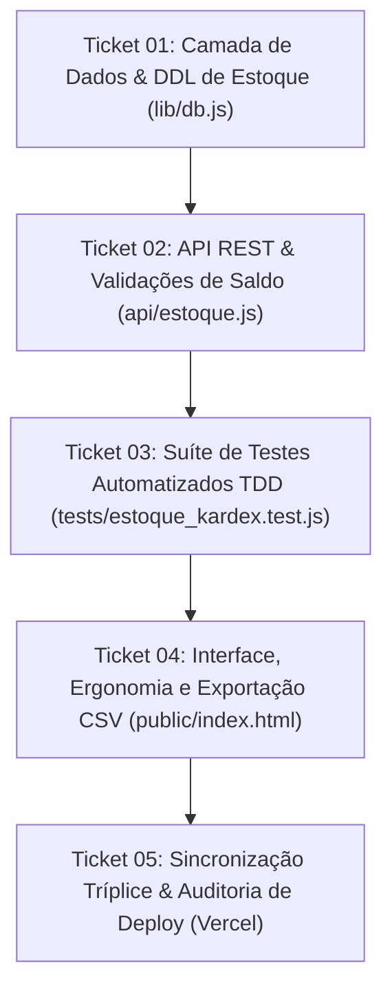

# Plano de Execução em Tickets: Módulo Universal de Estoque & Ficha Kardex

- **Documento:** `docs/TICKETS_ESTOQUE_KARDEX.md`
- **Especificação de Referência:** [`SPEC_ESTOQUE_KARDEX.md`](file:///d:/projetos-agy/clientes/MisSuenos/SPEC_ESTOQUE_KARDEX.md)
- **Metodologia:** Fluxo de Engenharia (*Idea-to-Ship* / Etapa 3: `/to-tickets`)
- **Status:** Aguardando Aprovação para Execução com `/implement-spec`
- **Data:** 11 de Novembro de 2026
- **Autor:** Gustavo Rosa Informática

---

## 🧭 Sequência de Execução dos Tickets

---

### Ticket 01: Camada de Dados, DDL Idempotente e Índices de Auditoria
- **Objetivo:** Garantir a estrutura de persistência imutável da tabela `estoque_movimentacoes` e índices analíticos tanto no SQLite local quanto no Turso Cloud via `lib/db.js`.
- **Arquivos Envolvidos:**
  - `lib/db.js`
- **Ações a Executar:**
  1. Validar e consolidar a DDL da tabela `estoque_movimentacoes` dentro de `inicializarTabelas()` com constraints:
     - `tipo IN ('ENTRADA', 'SAIDA')`
     - `origem IN ('COMPRA', 'VENDA', 'AJUSTE_MANUAL', 'INVENTARIO', 'PRODUCAO', 'LOCACAO')`
     - `quantidade REAL NOT NULL CHECK(quantidade > 0)`
     - `saldo_anterior REAL NOT NULL` e `saldo_posterior REAL NOT NULL`
  2. Assegurar a criação do índice `idx_estoque_mov_prod` indexando `(produto_id, data_movimentacao DESC)`.
  3. Adicionar migração segura e transparente tanto para SQLite (`database/clientes.db`) quanto para Turso Cloud (`@libsql/client`).
- **Passo de Validação:**
  - Executar comando de inicialização e verificar no SQLite a criação da tabela e índices:
    `node -e "import('./lib/db.js').then(m => m.inicializarTabelas().then(() => console.log('Tabelas OK!')))"`
- **Status:** [x] Concluído (TDD Validado)

---

### Ticket 02: Motor de Negócios e API REST de Estoque com Blindagem de Saldo
- **Objetivo:** Consolidar os endpoints da API REST `/api/estoque` respeitando o dispatcher unificado (`api/index.js`), garantindo validações atômicas de quantidade, catalogação de motivos universais e bloqueio preventivo contra saldo negativo.
- **Arquivos Envolvidos:**
  - `api/estoque.js`
  - `api/index.js`
- **Ações a Executar:**
  1. Revisar `POST /api/estoque/movimentar`:
     - Validação estrita de `produto_id`, `tipo` (`ENTRADA` ou `SAIDA`), `motivo` e `quantidade > 0`.
     - Bloqueio imediato com HTTP 400 se `tipo === 'SAIDA'` e `quantidade > saldo_anterior` (*"Estoque insuficiente"*).
     - Execução atômica da atualização de `produtos.estoque_atual` e inserção em `estoque_movimentacoes`.
     - Registro de trilha de auditoria global via `registrarLog`.
  2. Revisar `GET /api/estoque/kardex/:produto_id`:
     - Retorno de metadados do produto, saldo atual, totais acumulados de entradas e saídas, e lista cronológica de movimentações com suporte a filtros de data (`inicio`, `fim`) e paginação/limite.
  3. Revisar `GET /api/estoque/motivos`:
     - Exposição do catálogo padronizado de motivos universais (comércio, indústria, selaria e locação de TI).
- **Passo de Validação:**
  - Teste de chamadas locais via script Node validando status 200 para consulta, 201 para movimentação e 400 para tentativas de saída com saldo insuficiente.
- **Status:** [x] Concluído (TDD Validado)

---

### Ticket 03: Suíte Completa de Testes Automatizados TDD (`tests/estoque_kardex.test.js`)
- **Objetivo:** Criar cobertura formal e rigorosa de testes unitários e de integração para o motor de estoque e ficha Kardex utilizando o runner nativo `node:test`.
- **Arquivos Envolvidos:**
  - `tests/estoque_kardex.test.js` (novo)
- **Ações a Executar:**
  1. Testar movimentação de `ENTRADA` (aumento de saldo anterior -> posterior com registro no Kardex).
  2. Testar movimentação de `SAIDA` com saldo suficiente (baixa atômica e consistência dos saldos).
  3. Testar bloqueio de `SAIDA` quando a quantidade solicitada for maior que o saldo em estoque (HTTP 400 e integridade mantida).
  4. Testar rejeição de parâmetros inválidos (quantidade zero, negativa ou tipo não reconhecido).
  5. Testar consulta da Ficha Kardex com cálculo de totalizadores de entradas, saídas e ordenação cronológica decrescente.
  6. Testar filtros por intervalo de datas (`inicio` e `fim`) no extrato Kardex.
  7. Testar carga de motivos universais (`GET /api/estoque/motivos`).
- **Passo de Validação:**
  - Executar `node --test tests/estoque_kardex.test.js` e verificar 100% dos testes passando sem falhas.
- **Status:** [x] Concluído (TDD Validado)

---

### Ticket 04: Interface, Ergonomia de Teclado e Exportação de Relatório CSV
- **Objetivo:** Auditar e refinar a experiência do usuário nos modais de Ajuste Manual de Estoque e Ficha Kardex em `public/index.html` em conformidade com as regras globais de ergonomia.
- **Arquivos Envolvidos:**
  - `public/index.html`
- **Ações a Executar:**
  1. **Modal de Ajuste Rápido (`#modal-ajuste-estoque`):**
     - Foco automático com seleção no campo de Quantidade ao abrir (`setTimeout(..., 50)`).
     - Atribuição de `tabindex="-1"` em botões secundários de alternância, fechar modal e cancelar.
     - Remoção de spinners nativos no campo de quantidade e estilização em caixa alta no motivo/observações.
  2. **Modal da Ficha Kardex (`#modal-ficha-kardex`):**
     - Cabeçalho corporativo com SKU, nome do produto e cards de KPIs (Saldo Físico, Total Entradas, Total Saídas).
     - Linhas da tabela com badges coloridos de contraste (verde para `ENTRADA`, vermelho para `SAIDA`).
     - Segmented control de filtro rápido (`[ Todos ]`, `[ Entradas ]`, `[ Saídas ]`) e busca textual em tempo real.
     - Botão de exportação **"📊 Exportar CSV"** com codificação UTF-8 BOM e separador `;` para abertura direta no Microsoft Excel sem corromper acentuação.
  3. **Integração na Tabela de Produtos:**
     - Botões dedicados de acesso rápido `[ ⚡ Ajustar ]` e `[ 📑 Kardex ]` nas linhas do catálogo e no menu de contexto.
- **Passo de Validação:**
  - Validação estática de tags HTML/JS e teste de exportação CSV sem erros de sintaxe.
- **Status:** [x] Concluído (TDD Validado)

---

### Ticket 05: Validação Global, Sincronização Tríplice e Deploy em Produção
- **Objetivo:** Executar a suíte completa de testes de regressão (108+ testes), propagar as melhorias universais para `MisSuenos-Dev` e `erp-base`, realizar o deploy na Vercel e auditar a produção.
- **Arquivos Envolvidos:**
  - Repositório `MisSuenos` (Produção)
  - Repositório `MisSuenos-Dev` (Desenvolvimento)
  - Repositório `erp-base` (Template Matriz Neutro)
  - `HANDOFF.md`
- **Ações a Executar:**
  1. Executar `npm test` garantindo que todos os testes existentes e os novos passem com 100% de sucesso.
  2. Commit e push na branch `main` de `MisSuenos`.
  3. Auditar status do deploy na nuvem via requisição HTTP (`https://missuenos.vercel.app`) validando status 200 e ETag.
  4. Sincronizar os arquivos universais com `MisSuenos-Dev` e com a matriz neutra `erp-base` (com filtro consciente).
  5. Atualizar o `HANDOFF.md` registrando o novo marco de entrega.
- **Passo de Validação:**
  - `npm test` com 100% de aprovação e retorno HTTP 200 na Vercel.
- **Status:** [x] Concluído (TDD Validado)
