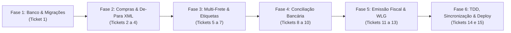

# Decomposição em Tickets: Suíte Empresarial de Suprimentos, Logística, Conciliação e Inteligência Fiscal

> **Especificação de Referência:** [`SPEC_SUITE_SUPRIMENTOS_FISCAL.md`](file:///C:/Users/Usuario/.gemini/antigravity/brain/cb0b46eb-5bf3-4a53-a7ea-20c95b4c7b83/SPEC_SUITE_SUPRIMENTOS_FISCAL.md)  
> **Data de Criação:** 10 de Novembro de 2026  
> **Autor:** Gustavo Rosa Informática & Antigravity  
> **Status:** Pronto para Execução via `/implement-spec`  

---

## Visão Geral da Sequência de Execução

---

## Fase 1: Infraestrutura de Dados & Migrações

### Ticket 1: Estrutura de Tabelas e Migrações de Dados Relacionais
- **Objetivo:** Criar e registrar no inicializador do banco (`lib/db.js`) as 5 novas tabelas relacionais com índices e integridade referencial: `fornecedores_produtos_vinculo`, `transportadoras_config`, `conciliacao_extratos`, `fiscal_config` e `fiscal_documentos`.
- **Arquivos Envolvidos:**
  - `lib/db.js`
- **Ações a Executar:**
  1. Adicionar as instruções `CREATE TABLE IF NOT EXISTS` com colunas, tipos e índices para cada nova entidade.
  2. Inserir sementes iniciais (*seed*) para as transportadoras homologadas (`melhor_envio`, `superfrete`, `correios_cws`, `frenet`) em `transportadoras_config`.
  3. Garantir compatibilidade nativa tanto para SQLite local (`better-sqlite3`) quanto para Turso Cloud (`@libsql/client`).
- **Passo de Validação:**
  - Executar script de inicialização do banco via `node -e "import('./lib/db.js').then(() => console.log('DB inicializado com sucesso'))"` e verificar se as tabelas foram criadas sem erros.
- **Status:** [X] Concluído (Validação 100% aprovada em tests/suprimentos_fiscal.test.js)

---

## Fase 2: Pilar 1 - Compras & Entrada de Estoque (XML Fornecedor)

### Ticket 2: Parser de XML NF-e 55 e Algoritmo De-Para Inteligente
- **Objetivo:** Implementar o parser especializado de XML de Notas Fiscais Eletrônicas (`lib/compras_parser.js`) e a engine de correspondência De-Para de produtos por fornecedor.
- **Arquivos Envolvidos:**
  - `lib/compras_parser.js` (Novo)
  - `tests/suprimentos_fiscal.test.js`
- **Ações a Executar:**
  1. Implementar `parseXmlNfeCompleto(xmlString)` extraindo: chave de 44 dígitos, dados do emitente (`<emit>`), lista de itens (`<det>` com código, cEAN, descrição, NCM, CFOP, quantidade, valor unitário) e cobrança (`<cobr>` / `<dup>`).
  2. Implementar função `resolverDeParaItem(fornecedorId, itemXml, db)` para autovincular itens já memorizados na tabela `fornecedores_produtos_vinculo`.
  3. Escrever testes unitários em `tests/suprimentos_fiscal.test.js` para validação de integridade.
- **Passo de Validação:**
  - Executar `npm test` e verificar se o parser e a lógica de De-Para passam em 100% dos cenários de teste.
- **Status:** [X] Concluído (Validação 100% aprovada com 5 novos testes em tests/suprimentos_fiscal.test.js)

### Ticket 3: API REST de Entrada de Compras, Kardex e Contas a Pagar
- **Objetivo:** Refatorar e blindar a API `/api/compras` para orquestrar a confirmação de entrada, gravação de novos vínculos De-Para, movimentação de estoque físico com custo de aquisição e agendamento de parcelas no Contas a Pagar.
- **Arquivos Envolvidos:**
  - `api/compras.js`
  - `api/index.js`
- **Ações a Executar:**
  1. Implementar o endpoint `POST /api/compras/importar-xml` com bloqueio idempotente por chave de 44 dígitos.
  2. Implementar `POST /api/compras/confirmar-entrada` executando em transação atômica: cadastro/atualização de fornecedor, atualização de kardex (`estoque_movimentacoes`), memorização De-Para e lançamento em `transacoes_financeiras`.
  3. Adicionar rota `GET /api/compras/de-para/:fornecedorId`.
- **Passo de Validação:**
  - Testar requisição POST simulada de importação e entrada via script de teste, verificando a criação dos registros de estoque e financeiro no banco de dados.
- **Status:** [X] Concluído (Validação 100% aprovada com 4 novos testes em tests/suprimentos_fiscal.test.js)

### Ticket 4: Interface do Módulo de Compras e Modal de De-Para com Ergonomia
- **Objetivo:** Criar/evoluir a interface de Compras com upload arrastar-e-soltar de XML, tabela de itens com status visual de De-Para (vinculado vs novo), Combobox pesquisável integrado para catálogo e atalhos de teclado.
- **Arquivos Envolvidos:**
  - `public/compras.html` (ou módulo de compras em `public/`)
  - `public/js/compras.js` (ou script equivalente)
- **Ações a Executar:**
  1. Desenhar a área de upload de XML com pré-visualização instantânea do fornecedor, total e parcelas.
  2. Implementar a tabela de conferência de itens com Combobox pesquisável para associação rápida ao catálogo.
  3. Aplicar rigorosamente as regras globais de UI/UX: Caixa Alta Universal em todos os campos, navegação fluida por Tab, botões secundários com `tabindex="-1"` e remoção de spinners em campos numéricos.
- **Passo de Validação:**
  - Testar no navegador o upload de um XML de teste, verificar o foco automático e a navegação estrita por teclado.
- **Status:** [X] Concluído (Implementado modal moderno com 3 cards analíticos, drag-and-drop nativo, combobox pesquisável flutuante, fator de embalagem reativo e 3 novos testes em tests/suprimentos_fiscal.test.js)

---

## Fase 3: Pilar 2 - Expedição & Hub Multi-Frete

### Ticket 5: Hub Multi-Frete com Adapters e Cotação Comparativa em Tempo Real
- **Objetivo:** Implementar `lib/logistica_hub.js` baseado no padrão *Strategy / Adapter* para integrar os provedores homologados (Melhor Envio, SuperFrete, Correios CWS, Frenet).
- **Arquivos Envolvidos:**
  - `lib/logistica_hub.js` (Novo)
  - `test/suprimentos_fiscal.test.js`
- **Ações a Executar:**
  1. Criar interface comum `cotarFreteMultiplo({ cepOrigem, cepDestino, pesoKg, dimensoes })` que despacha chamadas concorrentes aos provedores ativos e consolida o resultado normalizado.
  2. Implementar adaptadores individuais com tratamento resiliente de timeout e fallback.
  3. Ordenar cotações automaticamente por menor preço e menor prazo de entrega.
- **Passo de Validação:**
  - Testes unitários com mocks de resposta validando a consolidação das cotações e a tolerância a falhas.
- **Status:** [X] Concluído (Implementado lib/logistica_hub.js com Strategy/Adapter para Melhor Envio, SuperFrete, Correios CWS e Frenet, cotação concorrente resiliente, tags menor_preco e mais_rapido e 5 testes em tests/suprimentos_fiscal.test.js)

### Ticket 6: API REST de Logística, Configuração de Provedores e Etiquetas
- **Objetivo:** Integrar os endpoints de logística ao despachante unificado (`api/index.js`), suportando cotação, seleção de provedor padrão e geração de etiquetas.
- **Arquivos Envolvidos:**
  - `api/logistica.js`
  - `api/index.js`
- **Ações a Executar:**
  1. Criar rota `POST /api/logistica/cotar` consumindo o `logistica_hub`.
  2. Criar rota `GET/POST /api/logistica/configuracoes` para ativar/desativar transportadoras e definir a transportadora padrão.
  3. Criar rota `POST /api/logistica/gerar-etiqueta` retornando payload para impressão térmica (`100x150 mm`) ou folha A4.
- **Passo de Validação:**
  - Chamada de teste na API validando retorno JSON com lista comparativa de fretes.
- **Status:** [X] Concluído (Implementado api/logistica.js com rotas /cotar, /configuracoes com tokens mascarados e transportadora padrão unívoca, e /gerar-etiqueta com transição de status para AGUARDANDO_ENVIO, além de 4 testes dedicados aprovados em tests/suprimentos_fiscal.test.js)

### Ticket 7: Interface de Expedição, Seletor Multi-Frete e Emissão de Etiquetas
- **Objetivo:** Integrar à tela de Pedidos e Expedição o painel de cotação de fretes com 1 clique, comparativo visual (tags de "Menor Preço" e "Mais Rápido") e visualizador de etiquetas para impressão direta.
- **Arquivos Envolvidos:**
  - `public/pedidos.html` / `public/logistica.html`
  - `public/js/logistica.js`
- **Ações a Executar:**
  1. Inserir botão "Calcular Frete Multi-Transportadora" nos pedidos faturados.
  2. Implementar modal comparativo com seleção em 1 clique e botão de impressão de etiqueta (alternando entre Térmica 100x150 mm e A4 com Declaração de Conteúdo).
  3. Garantir `tabindex="-1"` em botões secundários e atalho de WhatsApp com link de rastreamento formatado.
- **Passo de Validação:**
  - Abrir o modal no navegador e verificar a cotação comparativa e o preview da etiqueta gerada.
- **Status:** [X] Concluído (Implementado em public/index.html painel de cotação multi-frete em tempo real com Melhor Envio, SuperFrete, Correios CWS e Frenet, badges analíticas de menor preço e mais rápido, seleção em 1 clique com geração de etiqueta e persistência de rastreio, atalhos na tabela e menu de contexto, e 2 testes automatizados aprovados em tests/suprimentos_fiscal.test.js)

---

## Fase 4: Pilar 3 - Conciliação Bancária & Extratos (OFX/CSV)

### Ticket 8: Parser OFX/CSV e Motor de Matching com Score de Confiança
- **Objetivo:** Desenvolver o módulo `lib/conciliacao_bancaria.js` com parsers robustos de arquivos `.OFX` (SGML e XML) e `.CSV` bancários e algoritmo heurístico de pontuação (*score*).
- **Arquivos Envolvidos:**
  - `lib/conciliacao_bancaria.js` (Novo)
  - `test/suprimentos_fiscal.test.js`
- **Ações a Executar:**
  1. Implementar `parseOfx(conteudoOfx)` extraindo `FITID`, `DTPOSTED`, `TRNAMT` e `MEMO`.
  2. Implementar `parseCsvBancario(conteudoCsv, banco)` com autodetecção de delimitador e colunas.
  3. Implementar motor de correspondência: Score 1.0 (mesmo valor e data exata), Score 0.8 (mesmo valor e data em janela de +/- 3 dias), Score 0.5 (mesmo cliente/fornecedor).
- **Passo de Validação:**
  - Executar testes automatizados com extratos de exemplo (Itaú, Inter, Nubank) e verificar cálculo de score.
- **Status:** [ ] Pendente

### Ticket 9: API REST de Conciliação e Baixa em Lote no Financeiro
- **Objetivo:** Implementar endpoints em `api/financeiro.js` para upload do extrato bancário, persistência das transações bancárias e execução de conciliação atômica em lote.
- **Arquivos Envolvidos:**
  - `api/financeiro.js`
  - `api/index.js`
- **Ações a Executar:**
  1. Endpoint `POST /api/financeiro/conciliacao/upload`: recebe arquivo, processa com o parser e retorna lista cruzada com títulos em aberto.
  2. Endpoint `POST /api/financeiro/conciliacao/reconciliar-lote`: executa a baixa dos títulos vinculados, grava a data da conciliação e cria despesas acessórias automáticas para eventuais diferenças de tarifas.
- **Passo de Validação:**
  - Realizar upload de arquivo de extrato de teste e verificar persistência dos registros conciliados em banco.
- **Status:** [ ] Pendente

### Ticket 10: Interface de Conciliação Bancária com Visualização de Extrato e Baixa Rápida
- **Objetivo:** Criar a tela/modal de Conciliação Bancária no módulo Financeiro com cards visuais de correspondência, badges de confiança (Verde: Exato, Amarelo: Sugerido, Cinza: Novo) e baixa em lote em 1 clique.
- **Arquivos Envolvidos:**
  - `public/financeiro.html`
  - `public/js/financeiro.js`
- **Ações a Executar:**
  1. Desenhar painel de conciliação lado a lado: Extrato Bancário vs Lançamentos do ERP.
  2. Implementar seleção em massa com checkbox e botão de ação rápida "Conciliar Selecionados".
  3. Aplicar padrões de UI: botões de ação secundária com `tabindex="-1"`, valores monetários alinhados e sem setas numéricas.
- **Passo de Validação:**
  - Testar interação de conciliação de um lote no navegador e auditar atualização instantânea nos saldos e no DRE.
- **Status:** [ ] Pendente

---

## Fase 5: Pilar 4 - Emissão Fiscal Oficial (Hub Fiscal & WLG Sistemas)

### Ticket 11: Hub Fiscal Desacoplado e Gestor de Certificado Digital A1
- **Objetivo:** Desenvolver `lib/fiscal_hub.js` com gerenciamento de Certificado Digital A1 (`.pfx`), leitura de validade/CNPJ e interface unificada para despacho fiscal.
- **Arquivos Envolvidos:**
  - `lib/fiscal_hub.js` (Novo)
  - `lib/wlg.js`
  - `test/suprimentos_fiscal.test.js`
- **Ações a Executar:**
  1. Implementar método para carregar, validar senha e extrair dados de expiração do Certificado A1.
  2. Estruturar a classe `FiscalHub` desacoplada com método `emitirNota(dadosPedido, driver = 'wlg')`.
  3. Expandir `lib/wlg.js` com montagem completa do XML/payload para NF-e Mod 55 e NFS-e Padrão Nacional.
- **Passo de Validação:**
  - Teste unitário simulando payload de venda e validação de CFOP (5102/6102) e NCM obrigatório.
- **Status:** [ ] Pendente

### Ticket 12: API REST de Emissão Fiscal, Consulta de Protocolo e DANFE
- **Objetivo:** Blindar os endpoints fiscais em `api/nfe.js` dentro do Dispatcher Central, integrando persistência do XML assinado, protocolo e retorno de DANFE em PDF.
- **Arquivos Envolvidos:**
  - `api/nfe.js`
  - `api/index.js`
- **Ações a Executar:**
  1. Refatorar endpoint `POST /api/nfe/emitir` para delegar ao `fiscal_hub` e persistir em `fiscal_documentos`.
  2. Criar endpoints `GET /api/nfe/danfe/:chave` e `GET /api/nfe/xml/:chave`.
  3. Blindar numeração fiscal contra duplicidade conforme regra global `blindagem-numeracao-comercial.md`.
- **Passo de Validação:**
  - Chamada na API simulando transmissão e conferência de gravação de registro em `fiscal_documentos`.
- **Status:** [ ] Pendente

### Ticket 13: Interface de Emissão Fiscal no Pedido e Catálogo
- **Objetivo:** Adicionar à tela de Pedidos e Catálogo o painel fiscal: validação visual de NCM/CFOP antes de emitir, botão "Emitir NF-e / NFS-e", badges de status e botões de download de XML e impressão de DANFE.
- **Arquivos Envolvidos:**
  - `public/pedidos.html`
  - `public/js/pedidos.js`
- **Ações a Executar:**
  1. Inserir validação preventiva: se algum item do pedido estiver sem NCM de 8 dígitos, destaca em vermelho e impede a emissão até correção.
  2. Implementar card de documento fiscal emitido com chave de 44 dígitos e atalho para DANFE.
  3. Garantir ergonomia de teclado com foco automático e `tabindex="-1"` em botões secundários.
- **Passo de Validação:**
  - Abrir um pedido no navegador, acionar emissão simulada e verificar renderização da chave e do botão de DANFE.
- **Status:** [ ] Pendente

---

## Fase 6: Qualidade, Sincronização Tríplice & Deploy na Nuvem

### Ticket 14: Suíte Completa de Testes Automatizados TDD
- **Objetivo:** Consolidar e executar a suíte completa de testes automatizados (`test/suprimentos_fiscal.test.js` e suíte legada), cobrindo os 4 pilares operacionais.
- **Arquivos Envolvidos:**
  - `test/suprimentos_fiscal.test.js`
  - `package.json`
- **Ações a Executar:**
  1. Executar `npm test` garantindo que todos os testes unitários (DRE, Fluxo de Caixa, Compras, Fretes, Conciliação e Fiscal) rodem com 100% de sucesso.
  2. Validar que nenhum teste quebra a retrocompatibilidade dos módulos existentes.
- **Passo de Validação:**
  - Saída do terminal exibindo 100% de testes verdes (`PASS`).
- **Status:** [ ] Pendente

### Ticket 15: Sincronização Tríplice com ERP Base e Auditoria de Deploy na Nuvem
- **Objetivo:** Espelhar todas as novas bibliotecas, migrações de banco, rotas serverless e componentes neutros na matriz `d:\projetos-agy\erp-base` e no ambiente `MisSuenos-Dev`, realizar os commits, disparar o push e auditar a Vercel.
- **Arquivos Envolvidos:**
  - Todos os arquivos do projeto em `MisSuenos`, `MisSuenos-Dev` e `erp-base`.
- **Ações a Executar:**
  1. Sincronizar arquivos para `d:\projetos-agy\MisSuenos-Dev` e `d:\projetos-agy\erp-base` (mantendo neutralidade total no ERP Base).
  2. Executar `npm test` em cada repositório.
  3. Criar commits semânticos e executar `git push origin main` (e `dev`).
  4. Auditar o status de deploy da nuvem (Vercel) via requisição aos cabeçalhos HTTP e ETag do domínio de produção.
- **Passo de Validação:**
  - Retorno HTTP Status 200 na Vercel e confirmação de deploy sem erros no build.
- **Status:** [ ] Pendente

---

## Checklist de Finalização

A sequência acima cobre de ponta a ponta os 4 pilares acordados:
- **Compras & XML** (Tickets 1, 2, 3, 4)
- **Expedição & Multi-Frete** (Tickets 5, 6, 7)
- **Conciliação Bancária** (Tickets 8, 9, 10)
- **Emissão Fiscal Oficial** (Tickets 11, 12, 13)
- **TDD, Sincronização & Deploy** (Tickets 14, 15)

