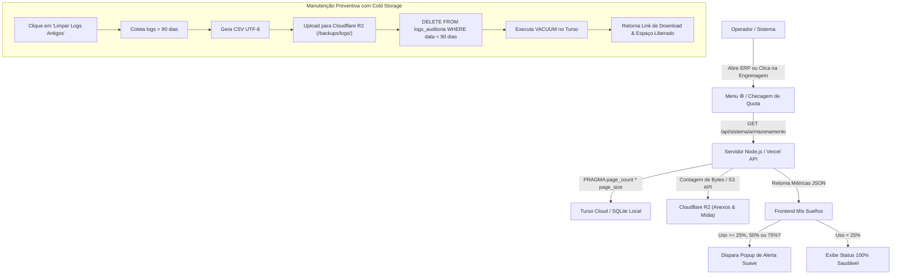

# Especificação Técnica: Armazenamento, Quotas e Arquivamento Frio (Cold Storage) no Cloudflare R2

- **Autor:** Gustavo Rosa Informática / Antigravity
- **Data:** 03 de Novembro de 2026
- **Status:** Proposta de Arquitetura (Fase 2 do Fluxo de Engenharia: `/to-spec`)
- **Projeto Alvo:** Mis Sueños ERP (`MisSuenos-Dev` e `MisSuenos` Produção)

---

## 1. Visão Geral e Contexto

O **Mis Sueños ERP** opera em arquitetura híbrida de alto desempenho: banco relacional distribuído **Turso Cloud (libSQL)** em produção na Vercel, persistência local **SQLite nativo (`clientes.db`)** em ambiente de suporte/desenvolvimento e armazenamento de arquivos de mídia (fotos de couros e XMLs) no **Cloudflare R2** / diretório local.

Para garantir previsibilidade técnica, sustentabilidade financeira no plano gratuito (*Starter/Freeware*) e evitar paradas acidentais por estouro de cota, esta especificação estabelece:
1. Telemetria e medição em tempo real do espaço ocupado no Turso Cloud, SQLite local e Cloudflare R2.
2. Alertas preventivos automáticos em popups suaves nos limiares de **25%**, **50%** e **75%** da capacidade.
3. Ferramentas de manutenção preventiva com **Cold Storage (Arquivamento Frio)** no Cloudflare R2, permitindo limpar tabelas pesadas (como logs de auditoria) sem perder o histórico do cliente.

---

## 2. Metas e Fora de Escopo

### Metas Principais (Goals):
* **Cálculo Preciso de Quotas:** Medir os bytes reais do banco via comandos `PRAGMA page_count` e `PRAGMA page_size` (multiplicação de blocos no SQLite/libSQL) e estatísticas de arquivos em disco e R2.
* **Acesso Rápido no Menu da Engrenagem ⚙️:** Adicionar a opção *"Armazenamento & Quotas"* no menu dropdown superior direito e no menu hambúrguer mobile.
* **Alertas Preventivos Graduais (25%, 50%, 75%):** Notificar o operador assim que qualquer serviço cruzar os marcos estabelecidos, com mecanismo de dispensa e controle anti-fadiga no `localStorage`.
* **Desfragmentação com VACUUM:** Permitir a reconstrução física contígua do banco para liberar espaço imediato em disco.
* **Arquivamento Frio no Cloudflare R2 (Opção B):** Ao expurgar logs de auditoria com mais de 90 dias, o sistema gera o pacote `.csv`, envia para o Cloudflare R2 (`backups/logs/...`) e remove as linhas do Turso, preservando o histórico perpétuo a custo zero.
* **Compatibilidade Total Mobile (PWA/iOS/Android) e Desktop:** O modal deve operar como Bottom Sheet tátil no celular e janela flutuante no desktop.

### Fora de Escopo (Non-Goals):
* Exclusão em massa ou expurgo de clientes reais ou pedidos (apenas logs de auditoria e arquivos temporários são expurgáveis).
* Integração paga com serviços fora do ecossistema homologado (restringindo-se estritamente a Turso, Cloudflare e SQLite).

---

## 3. Arquitetura e Fluxo de Execução



---

## 4. Contratos de Dados e Interfaces

### 4.1. Endpoint de Telemetria: `GET /api/sistema/armazenamento`
Retorna as estatísticas consolidadas para alimentar os gráficos e a checagem de limites.

**Resposta de Sucesso (`200 OK`):**
```json
{
  "sucesso": true,
  "data_consulta": "2026-11-03T00:10:00.000Z",
  "ambiente_banco": "Turso Cloud (libSQL)",
  "metricas": {
    "turso": {
      "usado_bytes": 15523840,
      "usado_formatado": "14.8 MB",
      "limite_bytes": 9663676416,
      "limite_formatado": "9.0 GB",
      "percentual_usado": 0.16,
      "alerta_nivel": "NORMAL"
    },
    "sqlite_local": {
      "usado_bytes": 2516582,
      "usado_formatado": "2.4 MB",
      "caminho": "database/clientes.db"
    },
    "r2_anexos": {
      "usado_bytes": 40055603,
      "usado_formatado": "38.2 MB",
      "limite_bytes": 10737418240,
      "limite_formatado": "10.0 GB",
      "percentual_usado": 0.38,
      "total_arquivos": 142
    }
  },
  "tabelas": [
    { "nome": "clientes", "registros": 1140, "tamanho_estimado": "1.45 MB", "percentual": 60.4 },
    { "nome": "pedidos", "registros": 28, "tamanho_estimado": "84 KB", "percentual": 3.5 },
    { "nome": "logs_auditoria", "registros": 3450, "tamanho_estimado": "720 KB", "percentual": 30.0 },
    { "nome": "anexos_metadata", "registros": 142, "tamanho_estimado": "120 KB", "percentual": 5.0 },
    { "nome": "produtos_estoque", "registros": 12, "tamanho_estimado": "24 KB", "percentual": 1.1 }
  ]
}
```

### 4.2. Endpoint de Otimização: `POST /api/sistema/otimizar`
Executa o `VACUUM` para reconstruir tabelas e liberar páginas livres.

**Resposta de Sucesso (`200 OK`):**
```json
{
  "sucesso": true,
  "mensagem": "Banco de dados desfragmentado e otimizado com sucesso!",
  "bytes_liberados": 245760,
  "tempo_execucao_ms": 38
}
```

### 4.3. Endpoint de Arquivamento Frio: `POST /api/sistema/limpar-logs`
**Payload de Entrada:**
```json
{
  "dias_retencao": 90,
  "enviar_r2": true
}
```
**Resposta de Sucesso (`200 OK`):**
```json
{
  "sucesso": true,
  "logs_arquivados": 1280,
  "arquivo_r2": "backups/logs/logs_auditoria_ate_2026-08-05.csv",
  "url_download_r2": "https://r2.missuenos.com.br/backups/logs/logs_auditoria_ate_2026-08-05.csv",
  "bytes_liberados_turso": "340 KB",
  "data_execucao": "2026-11-03T00:10:00.000Z"
}
```

---

## 5. Tratamento de Erros e Casos de Borda

1. **Credenciais do Cloudflare R2 Incompletas:**  
   Se o token R2 não estiver preenchido nas variáveis de ambiente, o sistema **não cancela o backup**: ele salva o arquivo de forma resiliente na pasta `/public/uploads/backups/` e gera o download direto no navegador do operador.
2. **Banco Bloqueado no Momento do VACUUM:**  
   Em caso de contenção com escrita simultânea (`SQLITE_BUSY`), o sistema aplica *retry exponencial* de 3 tentativas com pausas de 100ms.
3. **Prevenção de Fadiga de Alertas (UX):**  
   Os popups de 25%, 50% e 75% registram no `localStorage` a data da exibição. O alerta não volta a aparecer a cada refresh de tela a menos que o operador não o tenha dispensado ou se o patamar de consumo subir de nível.

---

## 6. Critérios de Aceite e Verificação

- [ ] **Acesso:** Item *"Armazenamento & Quotas"* visível e clicável no Menu da Engrenagem ⚙️ (Desktop e Mobile).
- [ ] **Visualização:** O modal abre com barras de progresso percentuais precisas para Turso (9GB), SQLite e R2 (10GB).
- [ ] **Simulação de Alerta:** Gatilhos visuais em 25%, 50% e 75% funcionam perfeitamente no simulador ou teste unitário.
- [ ] **Ação VACUUM:** O botão *"Otimizar Banco"* executa sem erros e exibe toast de confirmação.
- [ ] **Cold Storage R2:** A rotina de limpeza de logs gera o CSV dos registros com mais de 90 dias, salva o backup e remove do banco com liberação imediata de bytes.
- [ ] **Mobile:** Modal funciona como *Bottom Sheet* nativo com puxador e rolagem fluida em smartphones.

