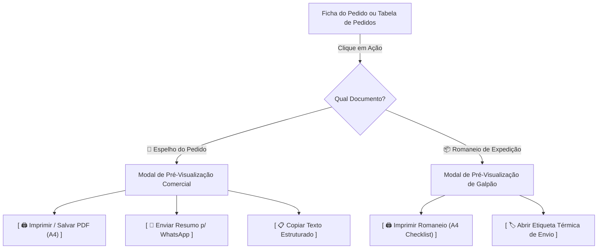

# Especificação Técnica: Espelho do Pedido / Orçamento em PDF & Romaneio de Expedição

> **Documento:** `SPEC-espelho-pedido-romaneio-pdf.md`  
> **Status:** Proposta para Aprovação  
> **Data:** 08 de Novembro de 2026  
> **Autor:** Antigravity / Pair Programming com Gustavo Rosa Informática  
> **Sistema Alvo:** Mis Sueños ERP (Produção e Matriz `erp-base`)  

---

## 1. Visão Geral e Contexto
Atualmente, o **Mis Sueños ERP** gerencia pedidos de venda com cálculo dinâmico de frete, itens múltiplos e etiquetas térmicas de envio. No entanto, quando um cliente solicita um orçamento formal ou a confirmação do pedido pelo WhatsApp, o operador depende de envio de texto não formatado. Da mesma forma, os ajudantes de estoque no depósito não dispõem de uma folha física/digital de conferência (romaneio de separação) para conferir itens, lotes e embalagens antes da expedição.

Esta especificação define a arquitetura, o design visual e o fluxo operacional de dois novos documentos padronizados do ERP:
1. **Espelho do Pedido / Proposta Comercial (A4 / PDF / WhatsApp):** Documento comercial de alto padrão com dados da empresa, dados do cliente, itens tabulados, cálculo unificado de frete, total geral, condições de pagamento e chave PIX com QR Code.
2. **Romaneio de Expedição / Folha de Separação de Galpão (A4):** Documento operacional simplificado para a expedição, com checklist de conferência, SKU, quantidades a separar, modalidade de envio (Superfrete, Jadlog, Correios) e campo de assinatura do estoquista.

---

## 2. Metas e Fora de Escopo

### Metas Principais (Goals):
- **Geração Direta em 1 Clique:** Botões acessíveis tanto no rodapé da Ficha do Pedido (`modal-pedido`) quanto no menu de ações rápidas da tabela de pedidos (`[ 📄 Espelho do Pedido ]` e `[ 📦 Romaneio de Expedição ]`).
- **Pré-visualização Interativa Pré-Impressão:** Modal moderno e fluido no padrão corporativo do ERP, permitindo conferir o layout antes de imprimir ou disparar.
- **Impressão Perfeita em Folha A4 (`@media print`):** CSS de impressão customizado sem cabeçalhos do navegador, sem cortes horizontais, sem páginas em branco extras e com fidelidade tipográfica em *JetBrains Mono*.
- **Compartilhamento Ágil no WhatsApp:** Botão `[ 💬 WhatsApp do Cliente ]` que monta mensagem formatada com resumo do pedido e link para download/visualização direta.
- **Cópia de Texto Comercial Estruturado:** Botão `[ 📋 Copiar Resumo ]` para colar rapidamente em conversas.
- **Compatibilidade White-Label com Matriz `erp-base`:** Logotipo, razão social, CNPJ, telefone e chave PIX alimentados dinamicamente pelas configurações da empresa (`configuracoes_sistema`), mantendo a matriz `erp-base` 100% neutra.

### Fora de Escopo (Non-Goals):
- Integração bancária direta via API para emissão de boleto registrado (permanecerá com chave PIX e formas de pagamento existentes).
- Envio automático de e-mail com anexo PDF por servidor SMTP nesta fase (o foco é WhatsApp e Impressão/Salvar PDF no navegador).

---

## 3. Arquitetura e Fluxo de Execução

---

## 4. Contratos de Dados e Estrutura dos Documentos

### 4.1. Espelho do Pedido / Proposta Comercial
- **Cabeçalho:**
  - Logotipo e Nome Comercial (`Mis Sueños Couros` ou valor configurado).
  - CNPJ, Inscrição Estadual, Telefone/WhatsApp e Endereço Oficial.
- **Identificação do Pedido:**
  - Número do Pedido: `#PED-XXXX` (em destaque).
  - Data e Hora de Emissão.
  - Vendedor / Operador responsável.
  - Status do Pedido (`Aguardando Envio`, `Faturado`, etc.).
- **Dados do Destinatário:**
  - Nome / Razão Social.
  - CPF / CNPJ e Telefone.
  - Endereço Completo de Entrega (Logradouro, Bairro, Cidade, UF, CEP).
- **Tabela de Itens:**
  - Colunas: `Item`, `Código / SKU`, `Descrição do Produto`, `Qtd`, `Unitário (R$)`, `Subtotal (R$)`.
- **Quadro de Totais:**
  - Subtotal dos Produtos: `R$ XXX,XX`
  - Valor do Frete / Envio: `R$ XX,XX`
  - **TOTAL GERAL DO PEDIDO:** `R$ XXX,XX` (em *JetBrains Mono* negrito).
- **Condições Comerciais & Pagamento:**
  - Forma de Pagamento (PIX, Boleto, Cartão, A Prazo).
  - Dados para Pagamento PIX: Tipo de Chave, Chave PIX e Nome do Favorecido.
  - Informações de Frete e Prazo de Entrega Estimado.

### 4.2. Romaneio de Expedição (Separação de Galpão)
- **Cabeçalho Operacional:** Título `ROMANEIO DE EXPEDIÇÃO & SEPARAÇÃO DE ESTOQUE`.
- **Identificação da Carga:** Número do Pedido, Destinatário, Cidade/UF, Transportadora e Código de Rastreio.
- **Tabela de Checklist para o Estoquista:**
  - `[ ]` Caixa de marcação de conferência física.
  - `Qtd a Separar` (em fonte grande e legível).
  - `SKU / Lote`.
  - `Descrição da Mercadoria`.
- **Quadro de Embalagem & Pesagem:**
  - Peso Bruto (kg), Medidas da Embalagem (A x L x C cm) e Volumes.
- **Rubrica de Conferência:**
  - `Conferido por: ________________________`
  - `Data: ____/____/________`

---

## 5. Tratamento de Erros e Casos de Borda
1. **Pedido sem Itens ou com Texto Legado:** A rotina executará `parseTextoParaItens()` para converter com segurança qualquer texto antigo sem perda de dados.
2. **Frete Zero:** O espelho exibirá "Frete: Grátis / Incluso" ou "R$ 0,00" sem ocultar o subtotal dos produtos.
3. **Quebra de Página na Impressão A4:** Utilização da regra CSS `page-break-inside: avoid;` nas tabelas e quadros de totais, impedindo que linhas de itens sejam cortadas ao meio entre páginas.
4. **Clientes sem Documento ou Endereço Parcial:** Os campos ausentes exibirão traço elegante (`—`) sem quebras no alinhamento visual.

---

## 6. Critérios de Aceite
- [ ] O botão `[ 📄 Espelho do Pedido ]` abre o modal de visualização instantaneamente na ficha do pedido.
- [ ] O botão `[ 📦 Romaneio de Expedição ]` abre a visualização de separação de galpão com checklist.
- [ ] O comando de impressão gera folha A4 vertical perfeita, sem elementos da interface do ERP e sem cortes.
- [ ] Os cálculos de Subtotal, Frete e Total Geral coincidem com 100% de precisão com a suíte de testes `tests/pedidos.test.js`.
- [ ] O botão WhatsApp gera a URL `https://wa.me/...` pronta para envio direto para o número do cliente.
- [ ] A sincronização tríplice com `MisSuenos-Dev` e `erp-base` mantém a matriz neutra.

