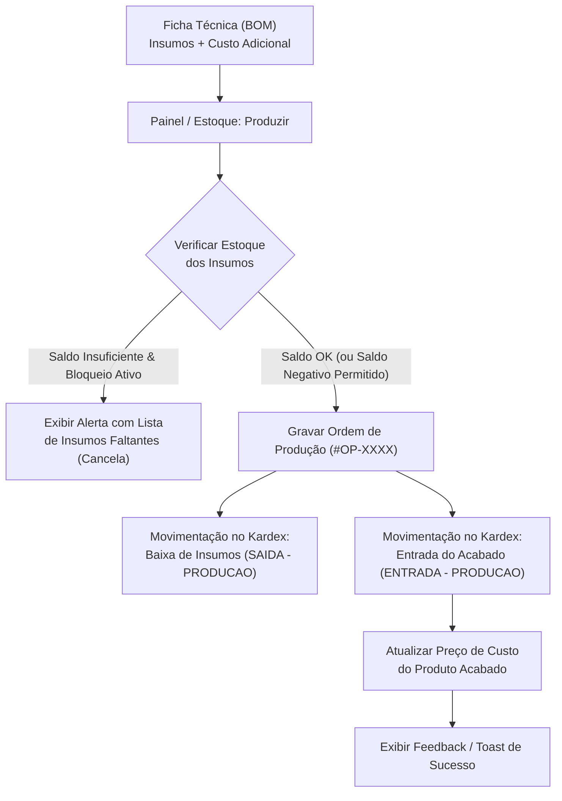

# Especificação Técnica: Ficha Técnica (BOM) & Ordens de Produção Artesanal

## 1. Visão Geral e Contexto
O ERP **Mis Sueños** e a matriz **erp-base** atualmente operam com controle de estoque e Kardex para produtos simples (entradas por compra/ajuste e saídas por venda). No entanto, como no ramo de couros, selaria e manufaturas artesanais muitos produtos finais são fabricados ou montados a partir de matérias-primas e peças (insumos), faz-se necessária a implementação de **Ficha Técnica (BOM - Bill of Materials)** e **Ordens de Produção / Montagem Direta**.

Inspirada no módulo de manufatura do **ERPNext**, esta funcionalidade permite vincular uma lista de insumos com suas respectivas quantidades a um produto acabado (com custo adicional opcional de mão de obra/serviço), permitindo disparar a produção em 1 clique, atualizando o Kardex com saída de insumos e entrada do acabado, calculando o custo de fabricação e possibilitando o estorno completo.

---

## 2. Metas e Fora de Escopo

### Metas Principais (In-Scope)
1. **Estrutura de Ficha Técnica (BOM):**
   - Definir os insumos que compõem um produto acabado (`produto_pai_id` -> lista de `produto_filho_id` com quantidades necessárias).
   - Suporte a campo de **Custo Adicional Fixo** (mão de obra/beneficiamento) no produto acabado.
   - Cálculo automático do custo unitário teórico de produção:
     $$\text{Custo Produção} = \sum (\text{Qtd Insumo} \times \text{Custo Unitário Insumo}) + \text{Custo Adicional}$$
2. **Montagem Rápida em 1 Clique (Batelada):**
   - Disparo simples e direto: o operador informa o produto e a quantidade desejada.
   - Validação prévia de saldo disponível de cada insumo no estoque.
3. **Política de Estoque Insuficiente Configurável:**
   - Parâmetro no banco de dados (`producao_permitir_saldo_negativo`):
     - `false` (Padrão): Bloqueio impeditivo com relatório claro de insumos faltantes.
     - `true`: Emissão de alerta visual, mas permitindo a gravação com saldo negativo temporário no Kardex se autorizado pelo administrador.
4. **Movimentação Atômica no Kardex (`estoque_movimentacoes`):**
   - Saída de cada insumo com `tipo: 'SAIDA'`, `origem: 'PRODUCAO'` e documento referenciando `#OP-XXXX`.
   - Entrada do produto acabado com `tipo: 'ENTRADA'`, `origem: 'PRODUCAO'` e custo médio atualizado.
5. **Estorno / Desmontagem de Produção:**
   - Botão para cancelar uma ordem de produção, revertendo os saldos no estoque (entrada dos insumos e saída do produto acabado).
6. **Padrões de UI/UX e Ergonomia:**
   - Caixa Alta Universal, sem spinners nativos em campos numéricos (`no-spin`), navegação fluida por `Tab` e combobox pesquisável para escolha de insumos e produtos.

### Fora de Escopo (Non-Goals)
- Apontamento contínuo de horas de operadores com cronômetro em tempo real (PCP industrial pesado).
- Estações de trabalho (*workstations*) com custos de amortização de máquinas.
- Quebras complexas de refugos percentuais por lote de corte nesta fase inicial.

---

## 3. Arquitetura e Fluxo de Execução



---

## 4. Contratos de Dados, Schemas DDL e Padrões de UI/UX

### A. Schema DDL (Idempotente para SQLite e Turso Cloud)

#### 1. Tabela `produtos_bom` (Ficha Técnica)
```sql
CREATE TABLE IF NOT EXISTS produtos_bom (
  id INTEGER PRIMARY KEY AUTOINCREMENT,
  produto_pai_id INTEGER NOT NULL,
  produto_filho_id INTEGER NOT NULL,
  quantidade REAL NOT NULL CHECK(quantidade > 0),
  observacoes TEXT,
  data_cadastro TEXT NOT NULL,
  FOREIGN KEY (produto_pai_id) REFERENCES produtos(id) ON DELETE CASCADE,
  FOREIGN KEY (produto_filho_id) REFERENCES produtos(id),
  UNIQUE(produto_pai_id, produto_filho_id)
);

CREATE INDEX IF NOT EXISTS idx_produtos_bom_pai ON produtos_bom(produto_pai_id);
```

#### 2. Tabela `producao_ordens` (Histórico de Produção)
```sql
CREATE TABLE IF NOT EXISTS producao_ordens (
  id INTEGER PRIMARY KEY AUTOINCREMENT,
  numero TEXT NOT NULL UNIQUE,
  produto_id INTEGER NOT NULL,
  quantidade REAL NOT NULL CHECK(quantidade > 0),
  custo_insumos REAL DEFAULT 0,
  custo_adicional REAL DEFAULT 0,
  custo_total REAL DEFAULT 0,
  custo_unitario_final REAL DEFAULT 0,
  status TEXT NOT NULL CHECK(status IN ('CONCLUIDA', 'ESTORNADA')) DEFAULT 'CONCLUIDA',
  data_producao TEXT NOT NULL,
  data_estorno TEXT,
  motivo_estorno TEXT,
  operador_nome TEXT,
  observacoes TEXT,
  itens_consumidos TEXT,
  FOREIGN KEY (produto_id) REFERENCES produtos(id)
);

CREATE INDEX IF NOT EXISTS idx_producao_ordens_prod ON producao_ordens(produto_id);
CREATE INDEX IF NOT EXISTS idx_producao_ordens_num ON producao_ordens(numero);
```

#### 3. Novas Colunas na Tabela `produtos`
- `custo_adicional_producao REAL DEFAULT 0` (mão de obra / beneficiamento fixo unitário).
- `tipo_item TEXT DEFAULT 'SIMPLES'` (`'SIMPLES'`, `'FABRICADO'`, `'INSUMO'`).

#### 4. Configuração do Sistema (`configuracoes_sistema`)
- Chave: `producao_permitir_saldo_negativo` (Valor: `'0'` ou `'1'`).

---

## 5. Tratamento de Erros, Casos de Borda e Integridade

1. **Blindagem Preventiva de Numeração Comercial (`#OP-XXXX`):**
   - Cálculo via regex `match(/\d+/)` sobre o maior número de OP existente (`maiorNumero + 1`), com verificação preventiva no backend para garantir zero erro de `UNIQUE constraint failed`.
2. **Transação Atômica:**
   - A baixa dos $N$ insumos e a entrada do produto acabado ocorrem em transação única (`BEGIN TRANSACTION` / `COMMIT`). Se ocorrer qualquer erro, é realizado `ROLLBACK` integral.
3. **Prevenção de Ciclos Infinitos / Recursão:**
   - Validação impedindo que um produto seja insumo de si próprio (`produto_filho_id !== produto_pai_id`).
4. **Proteção contra Estorno Duplo:**
   - Apenas ordens com `status === 'CONCLUIDA'` podem ser estornadas. Ao estornar, o status passa para `'ESTORNADA'` e os estornos no Kardex referenciam `ESTORNO #OP-XXXX`.

---

## 6. Critérios de Aceite, Testes e Sincronização

1. **Testes Automatizados (TDD):**
   - Criação de suíte de testes em `tests/producao_bom.test.js` com 100% de aprovação.
2. **Sincronização Tríplice:**
   - Matriz Universal: `d:\projetos-agy\erp-base`.
   - Cliente: `d:\projetos-agy\clientes\MisSuenos` (`main`).
   - Sandbox Dev: `D:\projetos-agy\sandbox\MisSuenos-Dev` (`dev`).
3. **Auditoria de Deploy:**
   - Deploy auditado e respondendo `HTTP 200 OK` na Vercel (`https://missuenos.vercel.app`).
