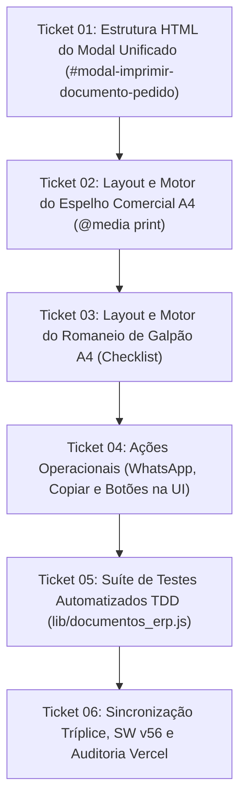

# Plano de Execução granular (Tickets): Espelho do Pedido & Romaneio de Expedição

> **Documento:** `TICKETS-espelho-pedido-romaneio-pdf.md`  
> **Referência:** `SPEC-espelho-pedido-romaneio-pdf.md`  
> **Status:** Pronto para Execução  
> **Data:** 08 de Novembro de 2026  
> **Autor:** Antigravity / Pair Programming com Gustavo Rosa Informática  
> **Sistema Alvo:** Mis Sueños ERP (Produção e Matriz `erp-base`)  

---

## Sequência de Execução dos Tickets

---

### Ticket 01: Estrutura HTML do Modal Unificado de Documentos
- **Objetivo:** Criar a janela modal corporativa de pré-visualização de documentos (`#modal-imprimir-documento-pedido`) em `public/index.html`.
- **Arquivos Envolvidos:** `public/index.html`
- **Ações a Executar:**
  1. Inserir a estrutura do modal com cabeçalho corporativo, abas rápidas para alternar entre "Espelho Comercial" e "Romaneio de Galpão", e botão de fechar `✕`.
  2. Adicionar o container `#corpo-documento-impressao` estilizado para simular a folha A4 vertical (proporção 210mm x 297mm) com rolagem fluida e fundo neutro de contraste.
  3. Adicionar a barra de ações no rodapé: `[ 🖨️ Imprimir / Salvar PDF ]`, `[ 💬 WhatsApp ]`, `[ 📋 Copiar Texto ]` e `[ ✕ Fechar ]`.
- **Passo de Validação:**
  - Verificação de sintaxe via script Node.js (`vm.Script`) garantindo integridade das tags e scripts.
- **Status:** [x] Concluído

---

### Ticket 02: Layout e Motor do Espelho do Pedido Comercial (A4 / PDF / WhatsApp)
- **Objetivo:** Implementar o motor gerador do Espelho do Pedido com design de alta fidelidade e regras `@media print`.
- **Arquivos Envolvidos:** `public/index.html`, `public/css/style.css` (ou bloco `<style>` unificado)
- **Ações a Executar:**
  1. Implementar a função `abrirEspelhoPedido(idOuObjeto)` que coleta dados do pedido, do cliente cadastrado e configurações da empresa.
  2. Implementar `gerarHtmlEspelhoPedido()` montando:
     - Cabeçalho corporativo com logotipo, Razão Social, CNPJ, Inscrição Estadual, Telefone/WhatsApp e Endereço.
     - Identificação destacada: Número `#PED-XXXX`, data/hora, vendedor e status.
     - Dados do destinatário: Nome, CPF/CNPJ, Telefone e Endereço completo.
     - Tabela de itens com SKU, Descrição, Qtd, Preço Unitário e Subtotal.
     - Quadro de Totais com Subtotal, Frete e Total Geral em *JetBrains Mono* negrito.
     - Dados de Pagamento (Forma, Chave PIX, Favorecido e QR Code PIX).
  3. Adicionar regras CSS `@media print` específicas que ocultam modais, barras e interfaces do ERP, aplicando `@page { size: A4 portrait; margin: 10mm; }` e `page-break-inside: avoid`.
- **Passo de Validação:**
  - Invocação da função no console/teste com pedidos de exemplo, verificando renderização sem erros e conformidade dos cálculos.
- **Status:** [x] Concluído

---

### Ticket 03: Layout e Motor do Romaneio de Expedição de Galpão (A4 Checklist)
- **Objetivo:** Implementar a folha operacional de separação de galpão para a expedição e estoque.
- **Arquivos Envolvidos:** `public/index.html`
- **Ações a Executar:**
  1. Implementar a função `abrirRomaneioExpedicao(idOuObjeto)`.
  2. Implementar `gerarHtmlRomaneioExpedicao()` montando:
     - Cabeçalho operacional: `ROMANEIO DE EXPEDIÇÃO & SEPARAÇÃO DE ESTOQUE`.
     - Identificação da carga: Número do Pedido, Destinatário, Cidade/UF, Transportadora e Rastreio.
     - Tabela de checklist de conferência: Checkbox físico `[  ]`, Quantidade em fonte grande (`1x`, `2x`), SKU/Lote e Descrição.
     - Quadro de pesagem, volumes e medidas.
     - Campos de rubrica: "Separado por", "Conferido por" e "Data".
  3. Ajustar estilos `@media print` para garantir tipografia limpa com economia de tinta e sem quebra indesejada de páginas.
- **Passo de Validação:**
  - Teste com pedido de múltiplos itens verificando se a visualização de galpão exibe todas as linhas e checkboxes.
- **Status:** [x] Concluído

---

### Ticket 04: Ações Operacionais (WhatsApp, Copiar e Botões na UI)
- **Objetivo:** Adicionar botões de disparo rápido e atalhos na interface do usuário.
- **Arquivos Envolvidos:** `public/index.html`
- **Ações a Executar:**
  1. Implementar `copiarResumoPedidoTexto(idOuObjeto)`: Monta resumo comercial em texto estruturado e copia para o Clipboard com notificação toast.
  2. Implementar `enviarPedidoWhatsApp(idOuObjeto)`: Constrói URL `https://wa.me/55...` com texto comercial codificado e abre em nova aba.
  3. Inserir botões no rodapé do `modal-pedido`: `[ 📄 Espelho do Pedido ]` e `[ 📦 Romaneio ]`.
  4. Inserir atalhos rápidos de impressão na tabela de pedidos do ERP.
- **Passo de Validação:**
  - Testar cliques nos botões da ficha do pedido e verificar abertura correta do modal com o documento respectivo.
- **Status:** [x] Concluído

---

### Ticket 05: Suíte de Testes Automatizados TDD (lib/documentos_erp.js)
- **Objetivo:** Blindar a lógica de geração de texto, totais e parsing de itens com testes unitários no Node.js.
- **Arquivos Envolvidos:** `lib/calculos_erp.js`, `tests/pedidos.test.js`
- **Ações a Executar:**
  1. Adicionar funções auxiliares de formatação de resumo em `lib/calculos_erp.js` (ou módulo dedicado).
  2. Criar testes unitários em `tests/pedidos.test.js` validando:
     - Conformidade dos totais do espelho com itens múltiplos e frete.
     - Tratamento de frete zero e frete com centavos.
     - Resumo em texto comercial sem valores nulos ou quebrados.
  3. Executar `npm test`.
- **Passo de Validação:**
  - `npm test` passando 100% dos testes sem falhas.
- **Status:** [x] Concluído

---

### Ticket 06: Sincronização Tríplice, SW v56 e Auditoria Vercel
- **Objetivo:** Atualizar cache do PWA, versionar alterações e sincronizar com os repositórios gêmeos.
- **Arquivos Envolvidos:** `public/sw.js`, `HANDOFF.md`, repositórios `MisSuenos-Dev` e `erp-base`.
- **Ações a Executar:**
  1. Atualizar a versão do Service Worker em `public/sw.js` para `missuenos-pwa-v56`.
  2. Realizar commit e push na branch `main` de `MisSuenos`.
  3. Auditar o deploy na Vercel via HTTP (ETag e Status 200).
  4. Sincronizar os arquivos com `MisSuenos-Dev` (commit na branch `dev`).
  5. Sincronizar com `erp-base` (mantendo-o neutro) e comitar na branch `main`.
  6. Atualizar `HANDOFF.md`.
- **Passo de Validação:**
  - `curl` ou script HTTP confirmando SW v56 ativo em `https://missuenos.vercel.app/sw.js`.
- **Status:** [ ] Pendente

